# Исследование реализаций динамического множества целых ключей с запросами.


## Цель работы.

Исследовать модель запросов на множестве целых ключей, реализованную на различных
структурах данных:
- std::set
- упорядоченный std::vector
- дополненное AVL - дерево
- B - дерево

## Методика измерений

Для выявления преимуществ одной структуры данных над другой в ходе исследования изменялись следующие параметры:

* Размер множеств
* Отношение $\frac{\text{число запросов}}{\text{число вставок}}$
* функция распределения ключей

На каждый эксперимент проводится измерение времени, в течении которого получается
результат обработки последовательности запросов.

Для измерения зависимости скорости обработки от величины $\frac{\text{число запросов}}{\text{число вставок}}$ рассматриваются три соотношения:

**(1.1)** $\frac{\text{число запросов}}{\text{число вставок}}$ = 0.3

**(1.2)** $\frac{\text{число запросов}}{\text{число вставок}}$ = 0.7

**(1.3)** $\frac{\text{число запросов}}{\text{число вставок}}$ = 1

Доля каждого из запросов q, m и n составляет $\frac{1}{3}$ от общего числа запросов.

В качестве размеров множеств были выбраны следующе значения: ```100, 10000, 1000000``` (шаг - множитель 100).
Для нахождения зависимости от размера множества ```N``` выполнялись запросы, количество которых определялось из соотношений `(1.1)` - `(1.3)`, причем для разных
структур данных, с одинаковой мощностью множества ключей, используется одна и та же последовательность запросов.


В качестве последовательности входных данных были выбраны следующие распределения ключей:

- По возрастанию. Сначала вставляются все ключи, потом идут все запросы.
- По возрастанию. Ключи и запросы распределены равномерно в общей последовательности.
- По убыванию. Сначала вставляются все ключи, потом идут все запросы.
- По убыванию. Ключи и запросы распределены равномерно в общей последовательности.
- Случайное. Сначала вставляются все ключи, потом идут все запросы.
- Случайно. Ключи и запросы распределены равномерно в общей последовательности.

В каждой из последовательности входных данных будут присутствовать дубликаты. Их доля от N задана и постоянна - ```35%```

Отличительной особенность B - дерева является то, что оно имеет свой внутренний параметр - степень дерева.
В основной части эксперимента будет выбрано значение ```t = 50```, а в дополнении к исследованию
будет приложена зависимость скорости обработки запросов B - дерева от t.

Для каждого множества ключей мощностью N выборка будет идти из диапазона [-0.5N, 0.5N].

## Архитектура

OS: macOS Sequoia 15.6

CPU: Apple M4

Компилятор: clang version 23.1.0

## Асимптотики реализаций

`N` — число ключей в множестве, `k` — число ключей в `(l, r]`, `t` — степень B-дерева.

| Операция                         | `std::set`                           | Упорядоченный `std::vector`             | AVL-дерево | B-дерево       |
|----------------------------------|--------------------------------------|-----------------------------------------|------------|-----------------|
| `k x` — вставка                  | `O(log N)`                           | `O(1)` амортизированно (запись в буфер) | `O(log N)` | `O(t · log_t N)`|
| `q l r` — число ключей в `(l, r]`| `O(log N + k)`, худший случай `O(N)` | `O(log N)` после слияния                | `O(log N)` | `O(t · log_t N)`|
| `m i` — i-й наименьший ключ      | `O(N)`                               | `O(1)` после слияния                    | `O(log N)` | `O(t · log_t N)`|
| `n x` — число ключей меньше `x`  | `O(N)`                               | `O(log N)` после слияния                | `O(log N)` | `O(t · log_t N)`|

## Ход работы

Подготовлены 54 скрипта для генерации 54 различных последовательностей входных данных.
Написан генератор бенч марков для измерения скорости работы алгоритмов на разных датасетах.
Затем отдельное построена зависимость скорости работы B - дерева от степени ```t```.

## Результаты

### std::set из стандартной библиотеки

При небольшом количестве вставляемых ключей (N ~ 10<sup>0</sup> - 10<sup>2</sup>) показывает
относительно неплохие временные результаты, но является самым медленным алгоритмом среди исследуемых при N > 10<sup>4</sup> ввиду линейной асимптотики при некоторых типах запросов. При N ~ 10<sup>6</sup> обработка входных данных занимает длительно время: порядка ```3 часов```. Границы применимости: 10<sup>0</sup> < N < 10<sup>4</sup>.

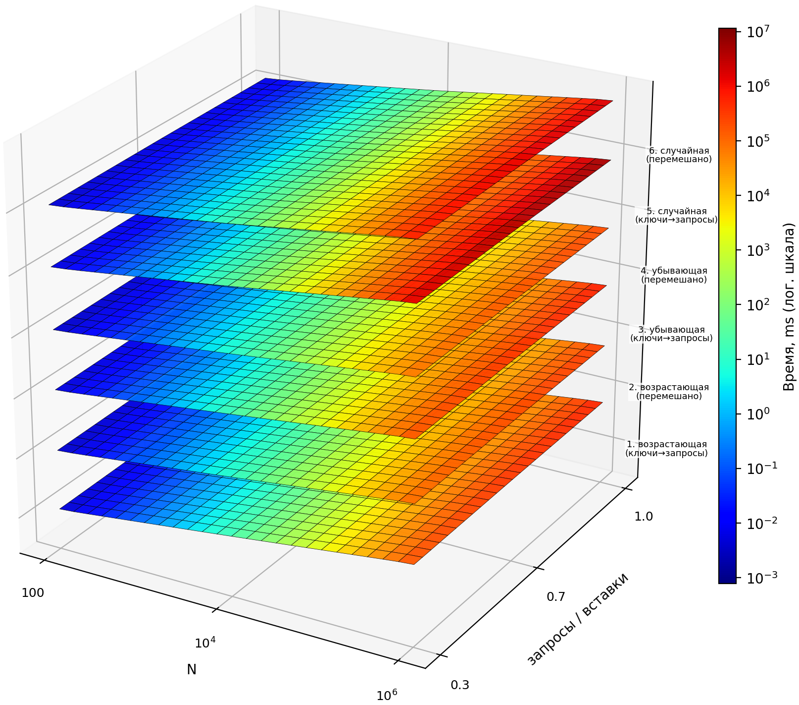

### упорядоченный std::vector

Является лучшей структурой данных в случае, когда сначала идет заполнение
множества ключей, а затем последовательные обращения к нему. Максимальное время ожидания исполнения всей последовательности
запросов порядка ```4 минут```. Имеет более низкие показатели на распределениях, где вставка и запросы чередуются.
Обоснованием этому является сортировка и слияние при каждом запросе.
Время работы пропорционально соотношению **$\frac{\text{число запросов}}{\text{число вставок}}$**.

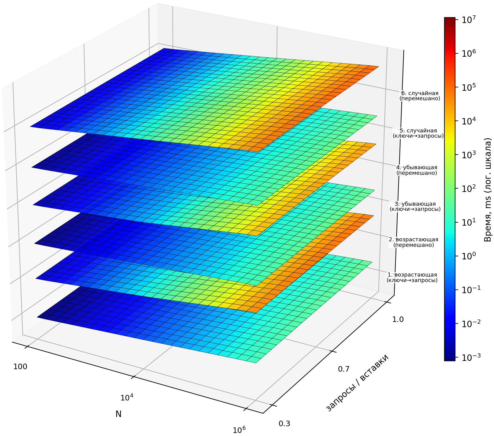

### avl - tree

Хорошо себя показывает на всех типах входных данных. Максимальное время ожидания исполнения всей последовательности
запросов порядка ```1 секунды```. Особенно выделяется по сравнению с ```std::vector``` и ```std::set``` при работе с распределениям типа, когда вставки и запросы равномерно распределены во входной последовательности. Однако временные показатели чуть больше временных показателей B - дерева. Это связано с постоянным промахом по кешу при обходе дерева. Слабо зависит от соотношения **$\frac{\text{число запросов}}{\text{число вставок}}$**, это хорошо видно по слабому наклону тепловой карты.

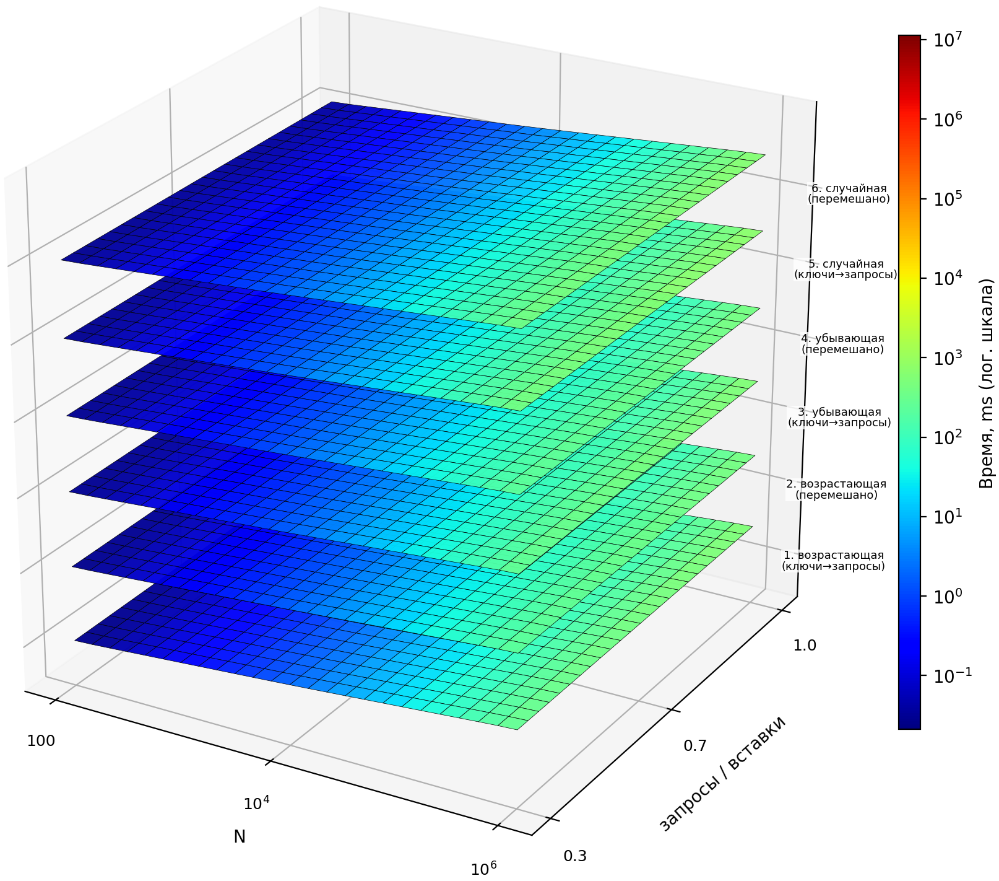

### b - tree

Хорошо себя показывает на всех типах входных данных. Максимальное время ожидания исполнения всей
последовательности запросов порядка ```1 секунды```. Хорошо справляется с большими объемами данных и занимает 1 - ое место при работе с распределениями, в которых вставки и запросы чередуются во входной последовательности. Слабо зависит от соотношения **$\frac{\text{число запросов}}{\text{число вставок}}$**, это хорошо видно по слабому наклону теплой карты. Имеет варьирующийся параметр - степень t.

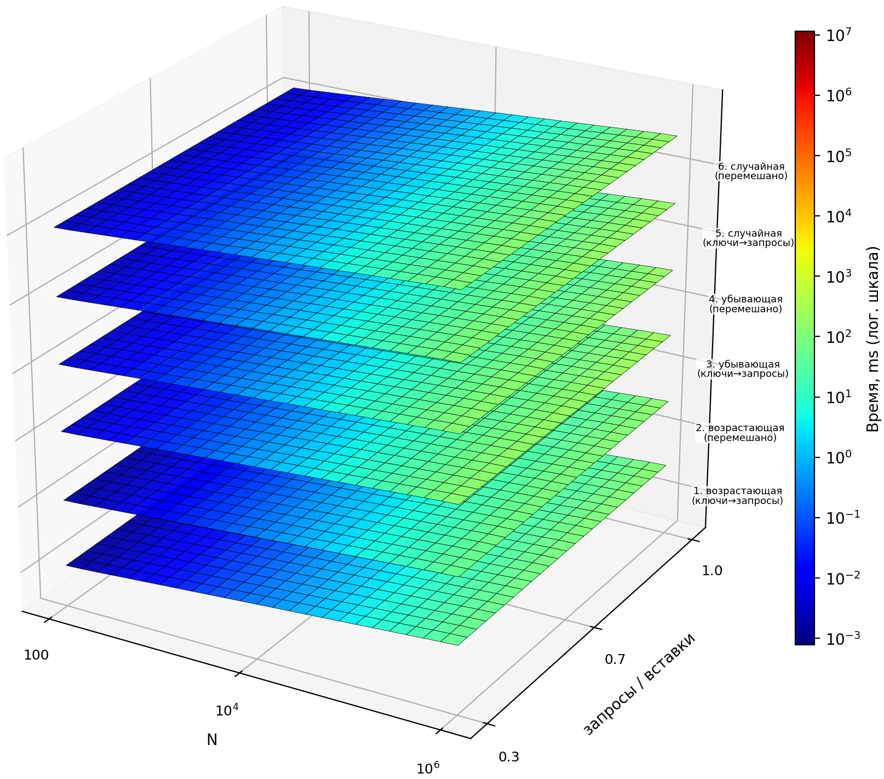

### Зависимость времени от степени B - дерева

Зависимость построим на одном конкретном примере. Основное
предназначенье B - деревьев это работа с большим объемом данных и
с медленной память. Поэтому для наблюдения зависимости рассмотрим следующий набор:

**Распределение:** случайное распределение, ключи и запросы равномерно перемешаны.

**$\frac{\text{число запросов}}{\text{число вставок}}$:** 0.3

**Уникальных ключей:** 1000000

**Дубликатов:** 350 000

**Датасет:** ```research/datasets/data_6_1_3.txt```

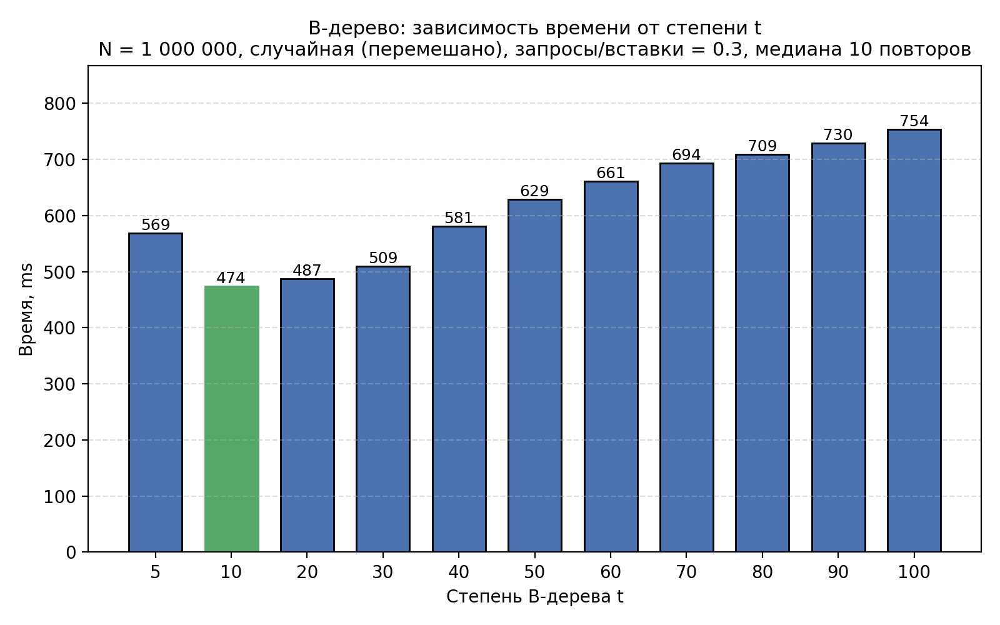


## Заключение

На входных данных, в которых сначала идет заполнение (вставка ключей), а затем запросы
ко множеству, лучшие показатели имеет ```упорядоченный std::vector```.


```Avl - дерево``` занимает первое и второе места в списке структур данных для поиска в случае, когда вставка ключей и
запросы распределены равномерно (равномерное чередовение).

```B - дерево``` занимает первое место среди исследуемых структур для поиска
при больших объемах данных (N ~ 10<sup>6</sup>) и чередовании вставок с запросами. Для B - дерева получена зависимость
времени работы от степени дерева: при ```5 < t < 20``` видим нисходящий тренд. Это
связано с тем, что при слишком малых t дерево начинает увеличиваться по высоте и быть слабо
отличимым от бинарных деревьев. При ```t > 30``` наблюдается восходящий тренд с небольшими флактуациями. Это объясняется
ростом линейного поиска внутри одного узла. Минимальное значение времени достигается при ```t = 30```.

```std::set``` проигрывает остальным алгоритмам ввиду того,
что выполнение запросов в конечном счете сводится к линейному перебору, в то время как у других
алгоритмов ($\log N$) и быстрее.

## Воспроизводимость

Запустить генерацию входных данных можно с помощью файлов генераторов, находящихся в
папке research/generators. Пример запуска из корня проекта:

```bash
python3 research/generators/generate_dataset_1_1_1.py
```

Создание гистограмм при запуске из корня проекта:

```bash
python3 research/generators/plot_histogram_1_1_1.py
```


## Приложение

### Измерение №1.1.1

**Распределение:** возрастающая последовательность, сначала все ключи, затем запросы

**$\frac{\text{число запросов}}{\text{число вставок}}$:** 0.3

**Уникальных ключей:** 100

**Дубликатов:** 35

**Датасет:** ```research/datasets/data_1_1_1.txt```

| Реализация     | Time, ms | CPU, ms  | Итераций | Отн. времени (лучший = 1.00) |
|----------------|----------|----------|----------|------------------------------|
| StdSet       | 0.003983 | 0.003983 |   175073 |                       5.14 |
| SortedVector | **0.0007749** | **0.0007749** | **896115** |                   **1.00** |
| AVL-tree     | 0.004312 | 0.004312 |   161503 |                       5.56 |
| B-tree       | 0.001293 | 0.001293 |   530709 |                       1.67 |

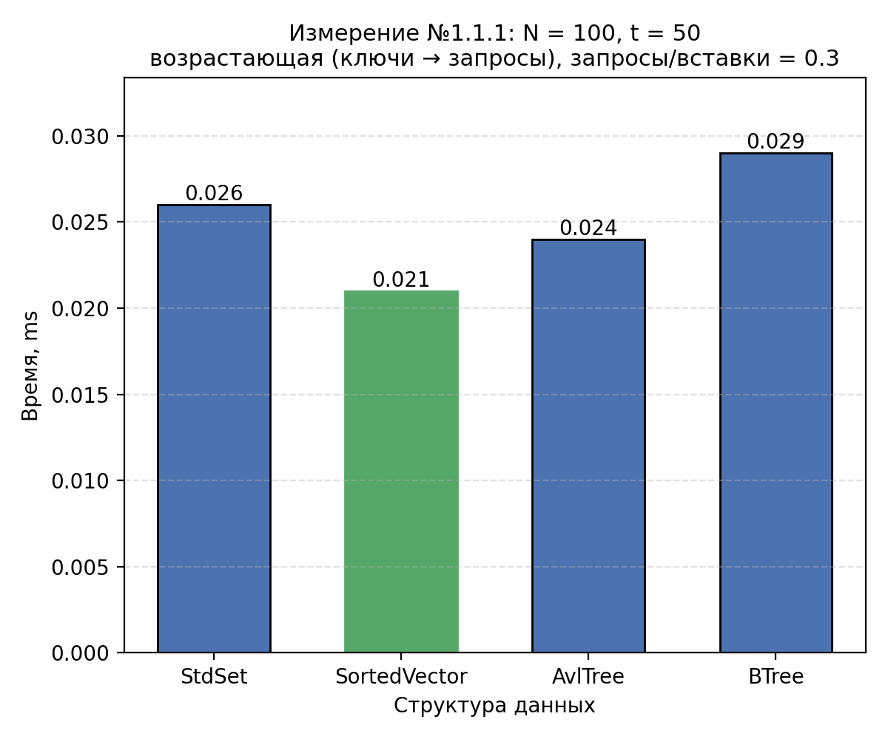

### Измерение №1.1.2

**Распределение:** возрастающая последовательность, сначала все ключи, затем запросы

**$\frac{\text{число запросов}}{\text{число вставок}}$:** 0.3

**Уникальных ключей:** 10000

**Дубликатов:** 3 500

**Датасет:** ```research/datasets/data_1_1_2.txt```

| Реализация     | Time, ms | CPU, ms  | Итераций | Отн. времени (лучший = 1.00) |
|----------------|----------|----------|----------|------------------------------|
| StdSet       |     30.8 |     30.8 |       23 |                     282.18 |
| SortedVector | **0.109** | **0.109** | **6046** |                   **1.00** |
| AVL-tree     |    0.767 |    0.755 |      888 |                       7.03 |
| B-tree       |    0.331 |    0.327 |     2167 |                       3.03 |

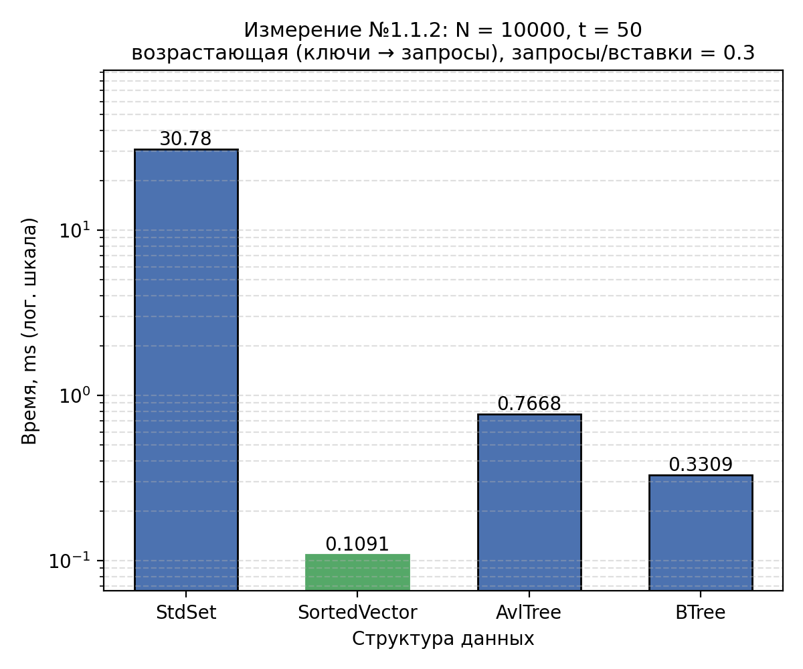

### Измерение №1.1.3

**Распределение:** возрастающая последовательность, сначала все ключи, затем запросы

**$\frac{\text{число запросов}}{\text{число вставок}}$:** 0.3

**Уникальных ключей:** 1000000

**Дубликатов:** 350 000

**Датасет:** ```research/datasets/data_1_1_3.txt```

| Реализация     | Time, ms | CPU, ms  | Итераций | Отн. времени (лучший = 1.00) |
|----------------|----------|----------|----------|------------------------------|
| StdSet       |   331388 |   331332 |        1 |                      15336 |
| SortedVector | **21.6** | **21.6** |   **32** |                   **1.00** |
| AVL-tree     |      206 |      206 |        3 |                       9.55 |
| B-tree       |       74 |       74 |       10 |                       3.42 |

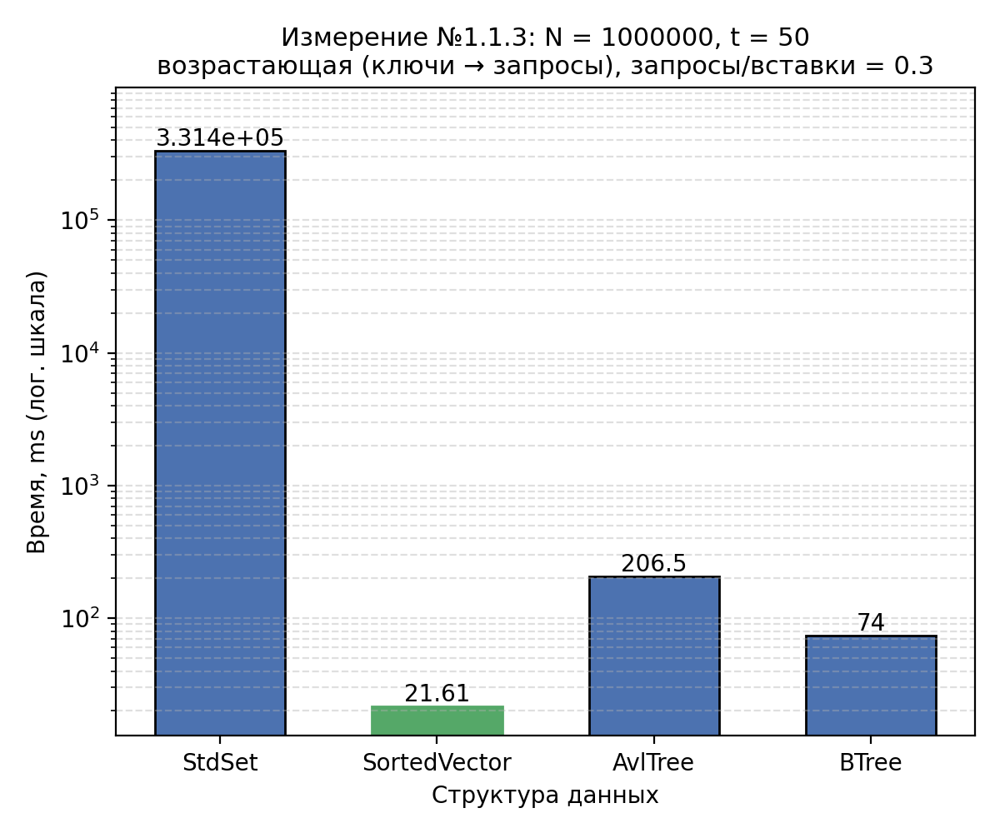

### Измерение №1.2.1

**Распределение:** возрастающая последовательность, сначала все ключи, затем запросы

**$\frac{\text{число запросов}}{\text{число вставок}}$:** 0.7

**Уникальных ключей:** 100

**Дубликатов:** 35

**Датасет:** ```research/datasets/data_1_2_1.txt```

| Реализация     | Time, ms | CPU, ms  | Итераций | Отн. времени (лучший = 1.00) |
|----------------|----------|----------|----------|------------------------------|
| StdSet       | 0.006972 | 0.006968 |   100808 |                       6.46 |
| SortedVector | **0.00108** | **0.001079** | **647327** |                   **1.00** |
| AVL-tree     | 0.004834 | 0.004821 |   146696 |                       4.48 |
| B-tree       | 0.002019 | 0.002019 |   348330 |                       1.87 |

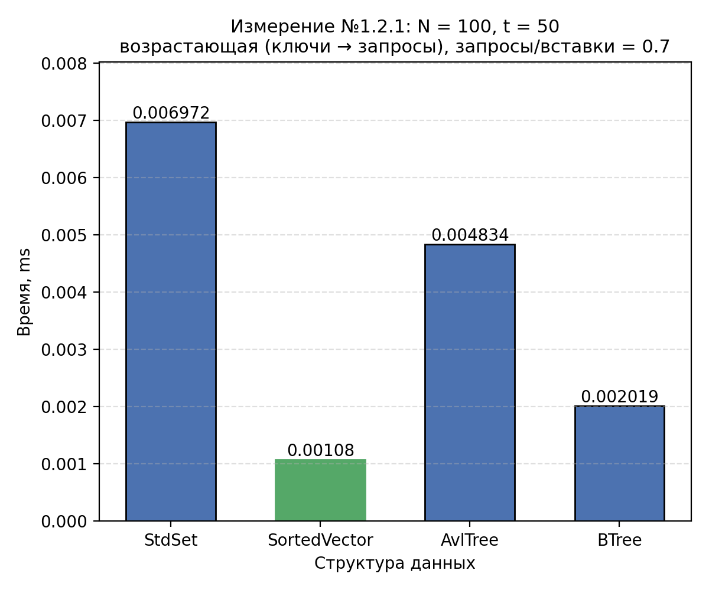

### Измерение №1.2.2

**Распределение:** возрастающая последовательность, сначала все ключи, затем запросы

**$\frac{\text{число запросов}}{\text{число вставок}}$:** 0.7

**Уникальных ключей:** 10000

**Дубликатов:** 3 500

**Датасет:** ```research/datasets/data_1_2_2.txt```

| Реализация     | Time, ms | CPU, ms  | Итераций | Отн. времени (лучший = 1.00) |
|----------------|----------|----------|----------|------------------------------|
| StdSet       |     73.5 |     73.4 |       10 |                     335.91 |
| SortedVector | **0.219** | **0.218** | **3062** |                   **1.00** |
| AVL-tree     |     1.04 |     1.03 |      638 |                       4.73 |
| B-tree       |    0.637 |    0.633 |     1136 |                       2.91 |

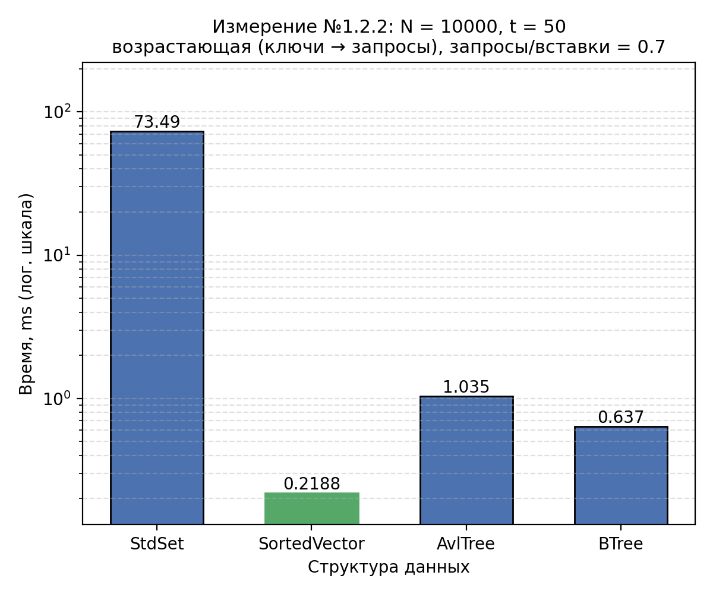

### Измерение №1.2.3

**Распределение:** возрастающая последовательность, сначала все ключи, затем запросы

**$\frac{\text{число запросов}}{\text{число вставок}}$:** 0.7

**Уникальных ключей:** 1000000

**Дубликатов:** 350 000

**Датасет:** ```research/datasets/data_1_2_3.txt```

| Реализация     | Time, ms | CPU, ms  | Итераций | Отн. времени (лучший = 1.00) |
|----------------|----------|----------|----------|------------------------------|
| StdSet       |   723418 |   723418 |        1 |                      16084 |
| SortedVector |   **45** |   **45** |   **14** |                   **1.00** |
| AVL-tree     |      309 |      309 |        2 |                       6.88 |
| B-tree       |      139 |      139 |        5 |                       3.09 |

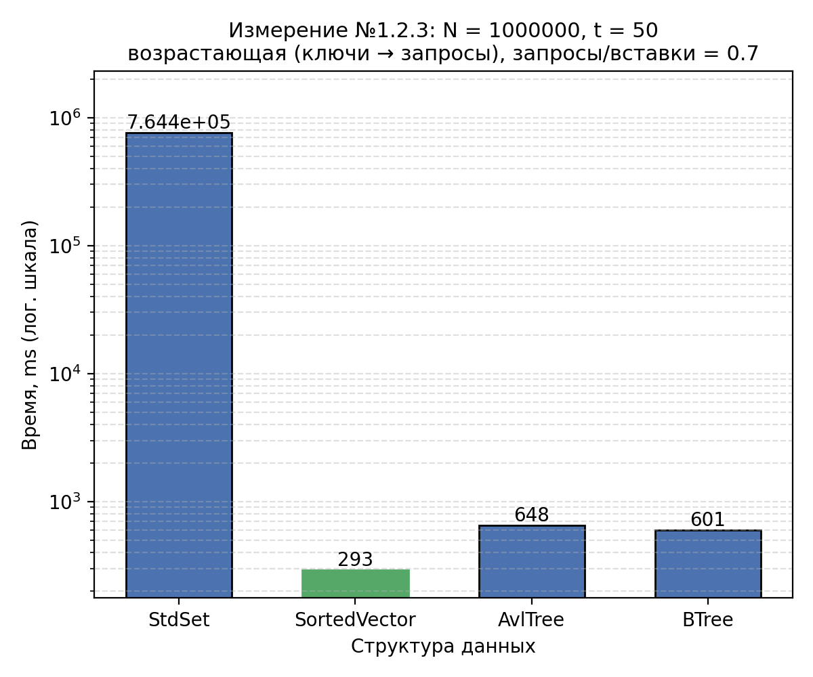

### Измерение №1.3.1

**Распределение:** возрастающая последовательность, сначала все ключи, затем запросы

**$\frac{\text{число запросов}}{\text{число вставок}}$:** 1.0

**Уникальных ключей:** 100

**Дубликатов:** 35

**Датасет:** ```research/datasets/data_1_3_1.txt```

| Реализация     | Time, ms | CPU, ms  | Итераций | Отн. времени (лучший = 1.00) |
|----------------|----------|----------|----------|------------------------------|
| StdSet       | 0.008687 | 0.008687 |    81366 |                       6.70 |
| SortedVector | **0.001297** | **0.001296** | **543381** |                   **1.00** |
| AVL-tree     | 0.005179 | 0.005177 |   136810 |                       3.99 |
| B-tree       | 0.002455 | 0.002451 |   282919 |                       1.89 |

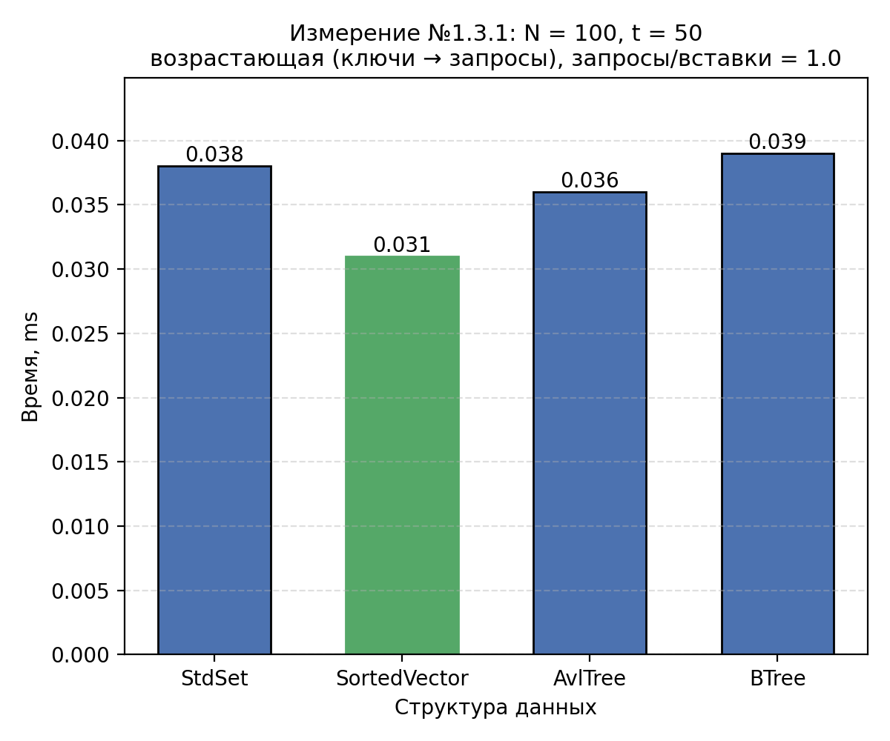

### Измерение №1.3.2

**Распределение:** возрастающая последовательность, сначала все ключи, затем запросы

**$\frac{\text{число запросов}}{\text{число вставок}}$:** 1.0

**Уникальных ключей:** 10000

**Дубликатов:** 3 500

**Датасет:** ```research/datasets/data_1_3_2.txt```

| Реализация     | Time, ms | CPU, ms  | Итераций | Отн. времени (лучший = 1.00) |
|----------------|----------|----------|----------|------------------------------|
| StdSet       |      100 |      100 |        7 |                     340.64 |
| SortedVector | **0.294** | **0.294** | **2305** |                   **1.00** |
| AVL-tree     |     1.33 |     1.33 |      550 |                       4.50 |
| B-tree       |    0.846 |    0.846 |      824 |                       2.87 |


### Измерение №1.3.3

**Распределение:** возрастающая последовательность, сначала все ключи, затем запросы

**$\frac{\text{число запросов}}{\text{число вставок}}$:** 1.0

**Уникальных ключей:** 1000000

**Дубликатов:** 350 000

**Датасет:** ```research/datasets/data_1_3_3.txt```

| Реализация     | Time, ms | CPU, ms  | Итераций | Отн. времени (лучший = 1.00) |
|----------------|----------|----------|----------|------------------------------|
| StdSet       |  1124741 |  1124741 |        1 |                      18221 |
| SortedVector | **61.7** | **61.7** |   **11** |                   **1.00** |
| AVL-tree     |      433 |      433 |        2 |                       7.02 |
| B-tree       |      200 |      200 |        3 |                       3.23 |

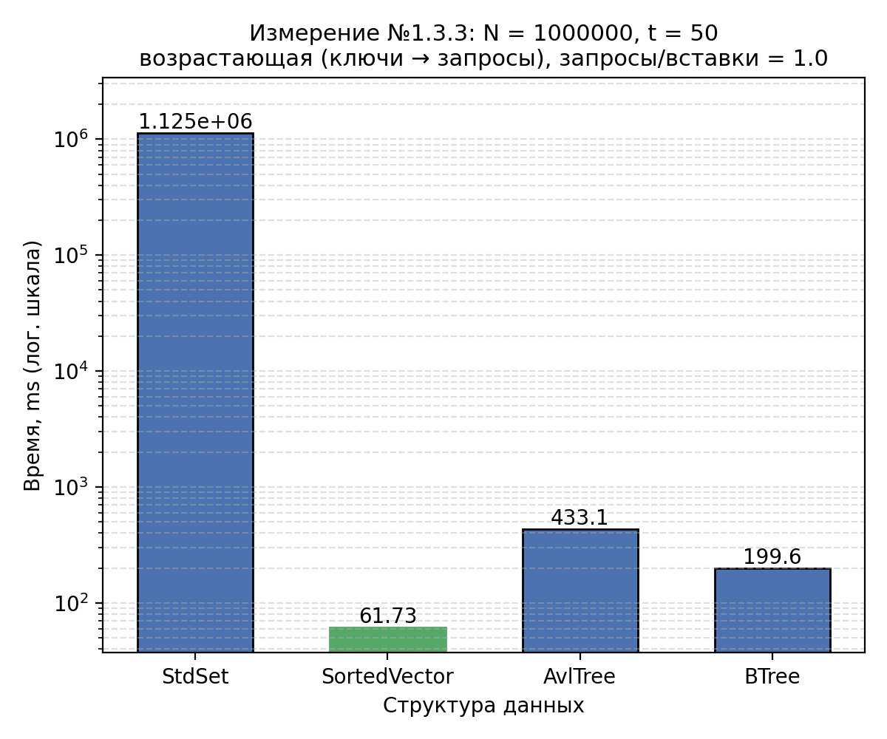

### Измерение №2.1.1

**Распределение:** возрастающая последовательность, ключи и запросы равномерно перемешаны

**$\frac{\text{число запросов}}{\text{число вставок}}$:** 0.3

**Уникальных ключей:** 100

**Дубликатов:** 35

**Датасет:** ```research/datasets/data_2_1_1.txt```

| Реализация     | Time, ms | CPU, ms  | Итераций | Отн. времени (лучший = 1.00) |
|----------------|----------|----------|----------|------------------------------|
| StdSet       | 0.003274 | 0.003274 |   214524 |                       2.54 |
| SortedVector |  0.00331 |  0.00331 |   211909 |                       2.57 |
| AVL-tree     | 0.004487 | 0.004487 |   160600 |                       3.48 |
| B-tree       | **0.001289** | **0.001289** | **540962** |                   **1.00** |

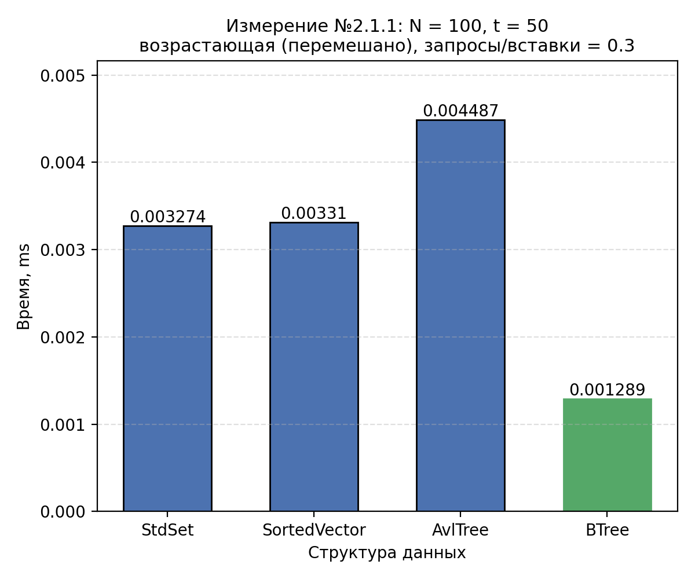

### Измерение №2.1.2

**Распределение:** возрастающая последовательность, ключи и запросы равномерно перемешаны

**$\frac{\text{число запросов}}{\text{число вставок}}$:** 0.3

**Уникальных ключей:** 10000

**Дубликатов:** 3 500

**Датасет:** ```research/datasets/data_2_1_2.txt```

| Реализация     | Time, ms | CPU, ms  | Итераций | Отн. времени (лучший = 1.00) |
|----------------|----------|----------|----------|------------------------------|
| StdSet       |     17.3 |     17.2 |       40 |                      47.20 |
| SortedVector |     7.72 |     7.72 |       90 |                      21.13 |
| AVL-tree     |    0.792 |    0.792 |      882 |                       2.17 |
| B-tree       | **0.366** | **0.366** | **1905** |                   **1.00** |

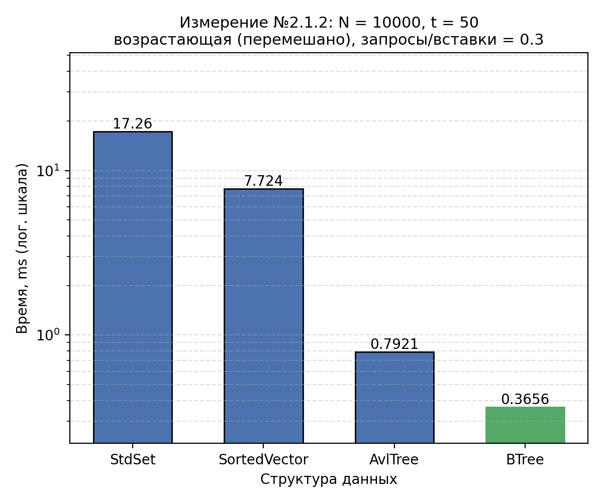

### Измерение №2.1.3

**Распределение:** возрастающая последовательность, ключи и запросы равномерно перемешаны

**$\frac{\text{число запросов}}{\text{число вставок}}$:** 0.3

**Уникальных ключей:** 1000000

**Дубликатов:** 350 000

**Датасет:** ```research/datasets/data_2_1_3.txt```

| Реализация     | Time, ms | CPU, ms  | Итераций | Отн. времени (лучший = 1.00) |
|----------------|----------|----------|----------|------------------------------|
| StdSet       |   180627 |   180627 |        1 |                       2270 |
| SortedVector |    82155 |    82155 |        1 |                       1032 |
| AVL-tree     |      178 |      178 |        4 |                       2.24 |
| B-tree       | **79.6** | **79.6** |    **8** |                   **1.00** |

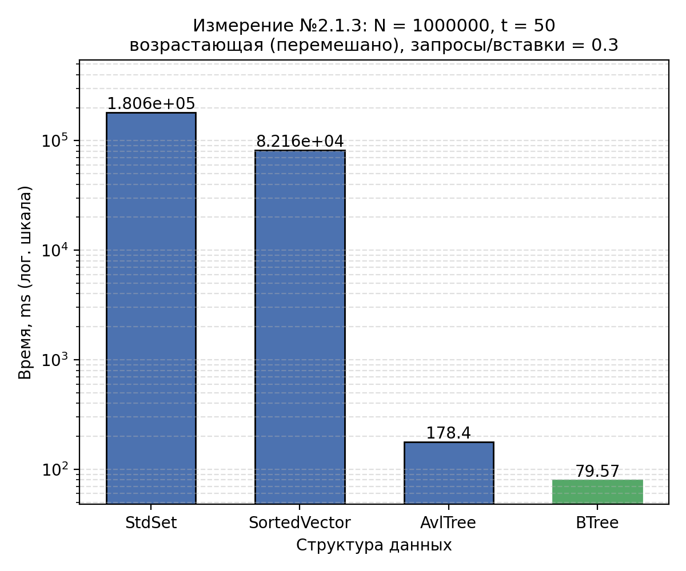

### Измерение №2.2.1

**Распределение:** возрастающая последовательность, ключи и запросы равномерно перемешаны

**$\frac{\text{число запросов}}{\text{число вставок}}$:** 0.7

**Уникальных ключей:** 100

**Дубликатов:** 35

**Датасет:** ```research/datasets/data_2_2_1.txt```

| Реализация     | Time, ms | CPU, ms  | Итераций | Отн. времени (лучший = 1.00) |
|----------------|----------|----------|----------|------------------------------|
| StdSet       | 0.005459 | 0.005459 |   136660 |                       2.62 |
| SortedVector | 0.007154 | 0.007154 |    97794 |                       3.43 |
| AVL-tree     | 0.004743 | 0.004743 |   147538 |                       2.27 |
| B-tree       | **0.002087** | **0.002087** | **335074** |                   **1.00** |

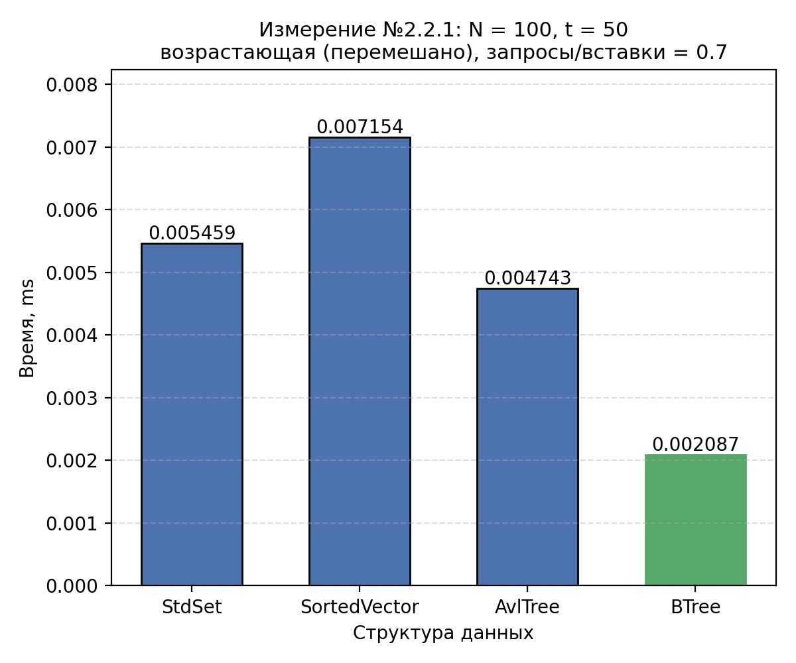

### Измерение №2.2.2

**Распределение:** возрастающая последовательность, ключи и запросы равномерно перемешаны

**$\frac{\text{число запросов}}{\text{число вставок}}$:** 0.7

**Уникальных ключей:** 10000

**Дубликатов:** 3 500

**Датасет:** ```research/datasets/data_2_2_2.txt```

| Реализация     | Time, ms | CPU, ms  | Итераций | Отн. времени (лучший = 1.00) |
|----------------|----------|----------|----------|------------------------------|
| StdSet       |     40.1 |     40.1 |       18 |                      58.25 |
| SortedVector |     13.8 |     13.8 |       50 |                      20.06 |
| AVL-tree     |    0.959 |    0.959 |      728 |                       1.39 |
| B-tree       | **0.689** | **0.689** | **1009** |                   **1.00** |

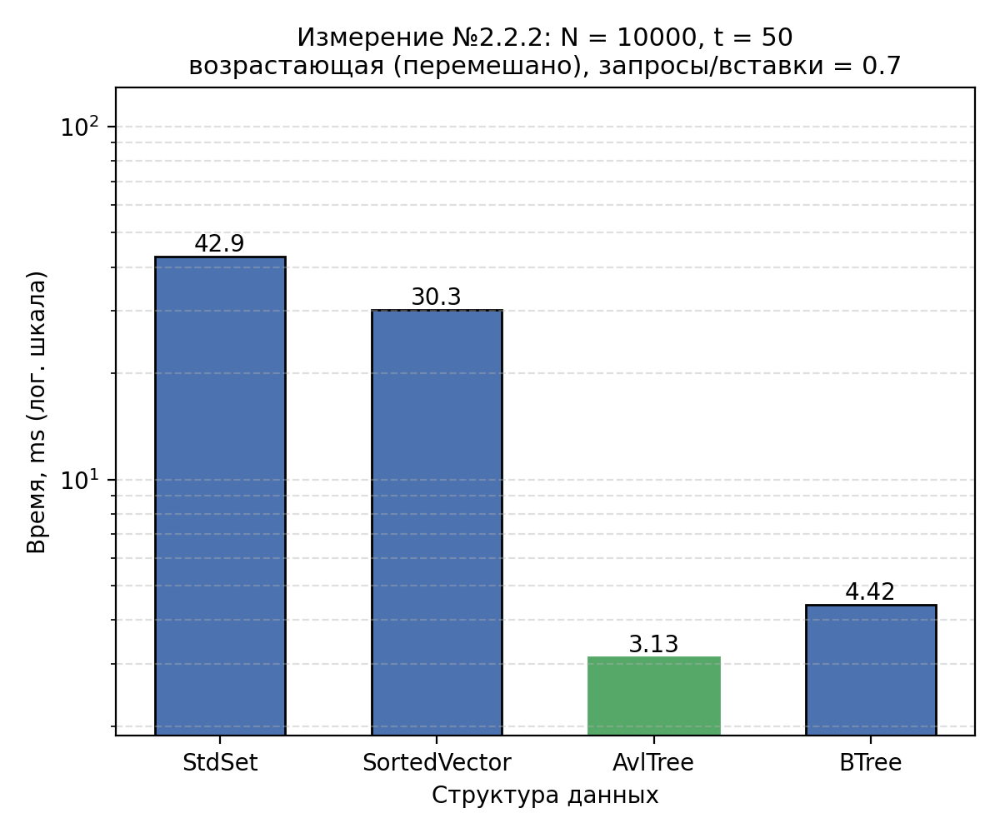

### Измерение №2.2.3

**Распределение:** возрастающая последовательность, ключи и запросы равномерно перемешаны

**$\frac{\text{число запросов}}{\text{число вставок}}$:** 0.7

**Уникальных ключей:** 1000000

**Дубликатов:** 350 000

**Датасет:** ```research/datasets/data_2_2_3.txt```

| Реализация     | Time, ms | CPU, ms  | Итераций | Отн. времени (лучший = 1.00) |
|----------------|----------|----------|----------|------------------------------|
| StdSet       |   440532 |   440532 |        1 |                       2788 |
| SortedVector |   153999 |   153999 |        1 |                     974.53 |
| AVL-tree     |      238 |      238 |        3 |                       1.51 |
| B-tree       |  **158** |  **158** |    **4** |                   **1.00** |

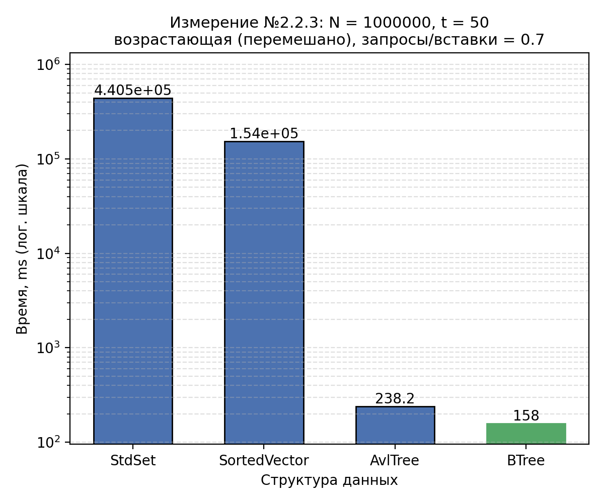

### Измерение №2.3.1

**Распределение:** возрастающая последовательность, ключи и запросы равномерно перемешаны

**$\frac{\text{число запросов}}{\text{число вставок}}$:** 1.0

**Уникальных ключей:** 100

**Дубликатов:** 35

**Датасет:** ```research/datasets/data_2_3_1.txt```

| Реализация     | Time, ms | CPU, ms  | Итераций | Отн. времени (лучший = 1.00) |
|----------------|----------|----------|----------|------------------------------|
| StdSet       | 0.006077 | 0.006077 |   116649 |                       2.47 |
| SortedVector | 0.007575 | 0.007575 |    91563 |                       3.08 |
| AVL-tree     | 0.005138 | 0.005138 |   139545 |                       2.09 |
| B-tree       | **0.002458** | **0.002458** | **295367** |                   **1.00** |

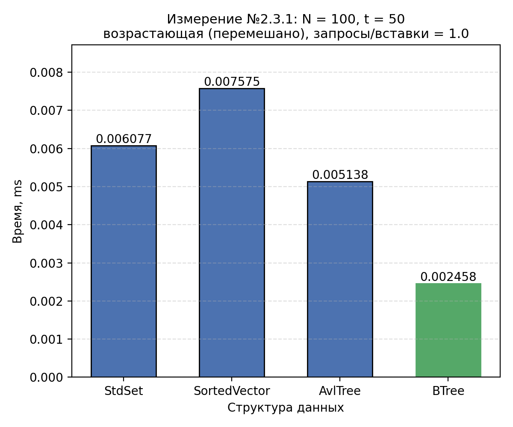

### Измерение №2.3.2

**Распределение:** возрастающая последовательность, ключи и запросы равномерно перемешаны

**$\frac{\text{число запросов}}{\text{число вставок}}$:** 1.0

**Уникальных ключей:** 10000

**Дубликатов:** 3 500

**Датасет:** ```research/datasets/data_2_3_2.txt```

| Реализация     | Time, ms | CPU, ms  | Итераций | Отн. времени (лучший = 1.00) |
|----------------|----------|----------|----------|------------------------------|
| StdSet       |     57.7 |     57.6 |       13 |                      60.26 |
| SortedVector |     17.7 |     17.7 |       39 |                      18.50 |
| AVL-tree     |     1.06 |     1.06 |      650 |                       1.10 |
| B-tree       | **0.958** | **0.958** |  **730** |                   **1.00** |

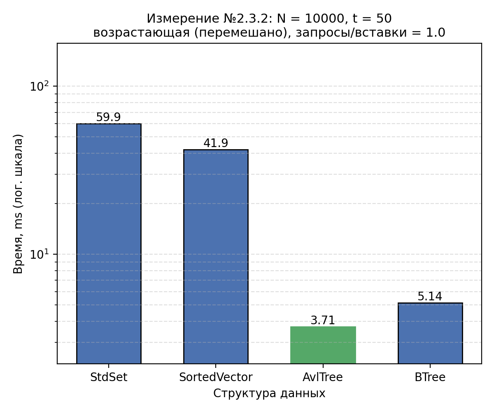

### Измерение №2.3.3

**Распределение:** возрастающая последовательность, ключи и запросы равномерно перемешаны

**$\frac{\text{число запросов}}{\text{число вставок}}$:** 1.0

**Уникальных ключей:** 1000000

**Дубликатов:** 350 000

**Датасет:** ```research/datasets/data_2_3_3.txt```

| Реализация     | Time, ms | CPU, ms  | Итераций | Отн. времени (лучший = 1.00) |
|----------------|----------|----------|----------|------------------------------|
| StdSet       |   617431 |   617431 |        1 |                       2904 |
| SortedVector |   167716 |   167716 |        1 |                     788.89 |
| AVL-tree     |      275 |      275 |        2 |                       1.30 |
| B-tree       |  **213** |  **213** |    **3** |                   **1.00** |

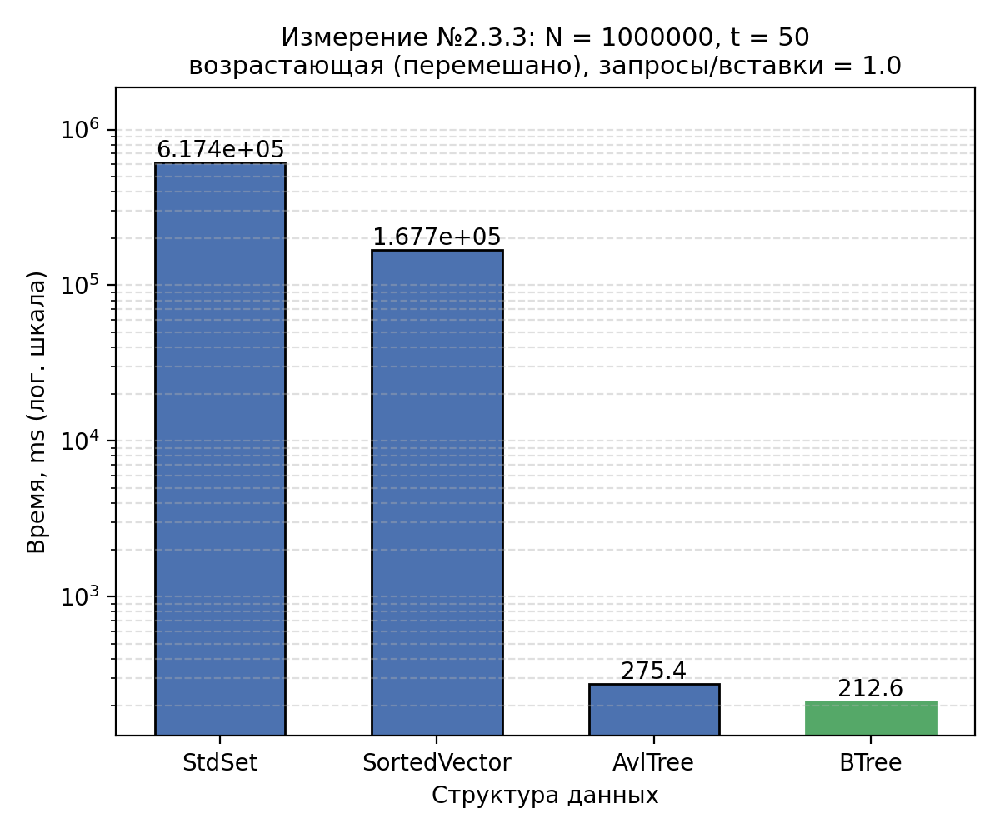

### Измерение №3.1.1

**Распределение:** убывающая последовательность, сначала все ключи, затем запросы

**$\frac{\text{число запросов}}{\text{число вставок}}$:** 0.3

**Уникальных ключей:** 100

**Дубликатов:** 35

**Датасет:** ```research/datasets/data_3_1_1.txt```

| Реализация     | Time, ms | CPU, ms  | Итераций | Отн. времени (лучший = 1.00) |
|----------------|----------|----------|----------|------------------------------|
| StdSet       | 0.004319 | 0.004319 |   161920 |                       4.96 |
| SortedVector | **0.000871** | **0.0008709** | **799059** |                   **1.00** |
| AVL-tree     | 0.004075 | 0.004075 |   170873 |                       4.68 |
| B-tree       | 0.003544 | 0.003544 |   194930 |                       4.07 |

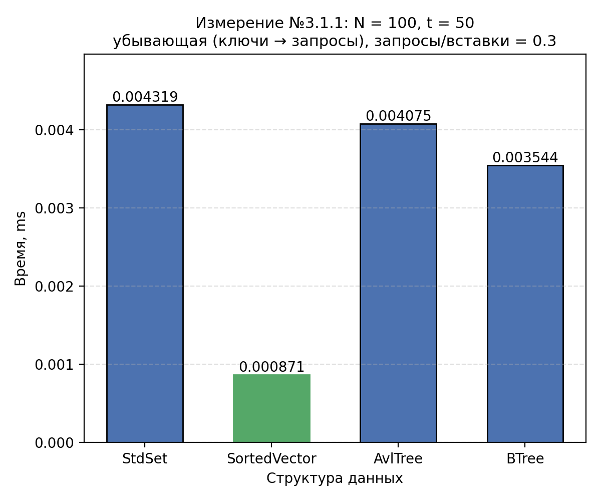

### Измерение №3.1.2

**Распределение:** убывающая последовательность, сначала все ключи, затем запросы

**$\frac{\text{число запросов}}{\text{число вставок}}$:** 0.3

**Уникальных ключей:** 10000

**Дубликатов:** 3 500

**Датасет:** ```research/datasets/data_3_1_2.txt```

| Реализация     | Time, ms | CPU, ms  | Итераций | Отн. времени (лучший = 1.00) |
|----------------|----------|----------|----------|------------------------------|
| StdSet       |       31 |       31 |       24 |                     246.72 |
| SortedVector | **0.126** | **0.126** | **5521** |                   **1.00** |
| AVL-tree     |    0.705 |    0.705 |      993 |                       5.61 |
| B-tree       |    0.977 |    0.977 |      707 |                       7.77 |

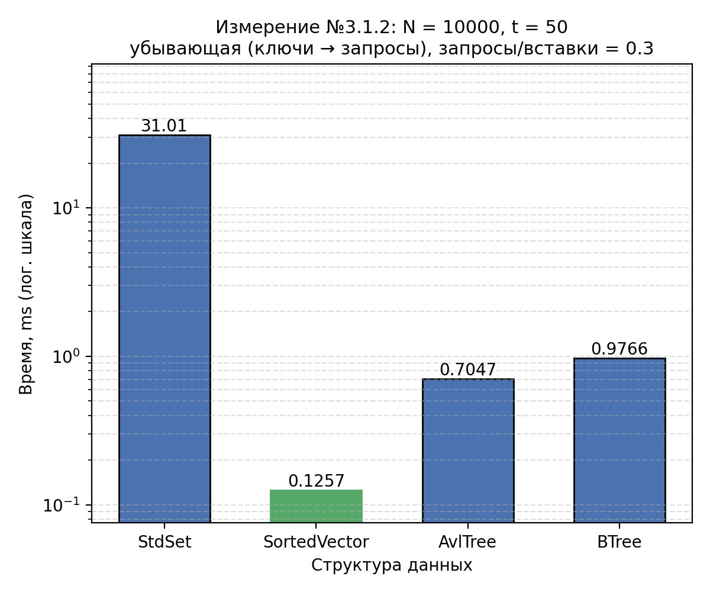

### Измерение №3.1.3

**Распределение:** убывающая последовательность, сначала все ключи, затем запросы

**$\frac{\text{число запросов}}{\text{число вставок}}$:** 0.3

**Уникальных ключей:** 1000000

**Дубликатов:** 350 000

**Датасет:** ```research/datasets/data_3_1_3.txt```

| Реализация     | Time, ms | CPU, ms  | Итераций | Отн. времени (лучший = 1.00) |
|----------------|----------|----------|----------|------------------------------|
| StdSet       |   326660 |   326660 |        1 |                      13338 |
| SortedVector | **24.5** | **24.5** |   **27** |                   **1.00** |
| AVL-tree     |      183 |      183 |        4 |                       7.47 |
| B-tree       |      228 |      228 |        3 |                       9.32 |

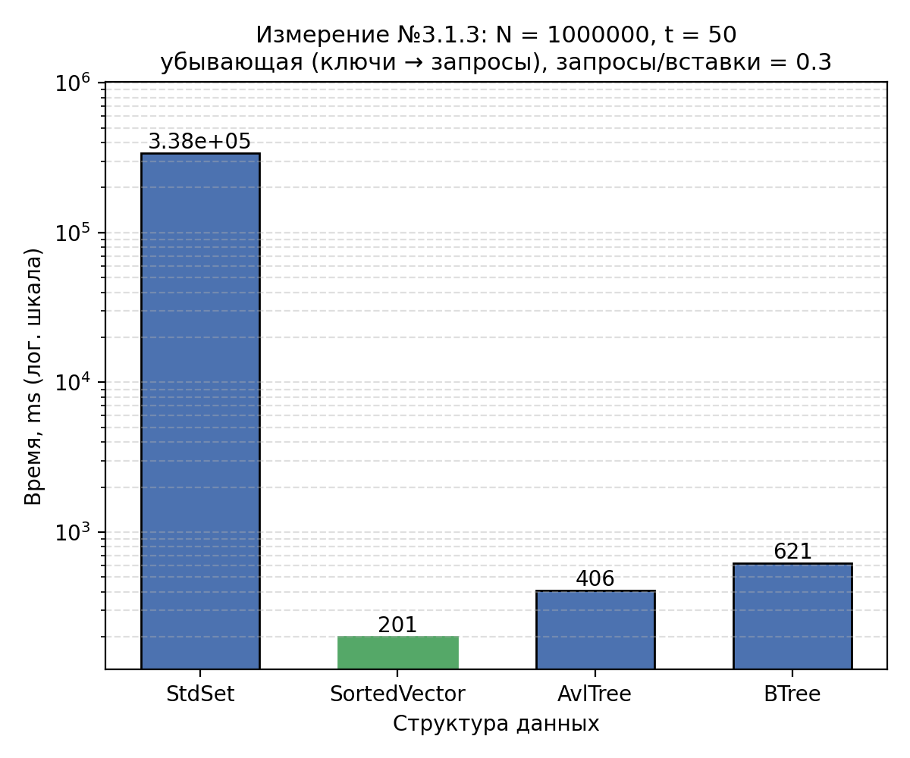

### Измерение №3.2.1

**Распределение:** убывающая последовательность, сначала все ключи, затем запросы

**$\frac{\text{число запросов}}{\text{число вставок}}$:** 0.7

**Уникальных ключей:** 100

**Дубликатов:** 35

**Датасет:** ```research/datasets/data_3_2_1.txt```

| Реализация     | Time, ms | CPU, ms  | Итераций | Отн. времени (лучший = 1.00) |
|----------------|----------|----------|----------|------------------------------|
| StdSet       | 0.006996 | 0.006996 |   102452 |                       6.11 |
| SortedVector | **0.001145** | **0.001145** | **608156** |                   **1.00** |
| AVL-tree     |  0.00439 |  0.00439 |   157652 |                       3.83 |
| B-tree       | 0.004267 | 0.004267 |   164000 |                       3.73 |

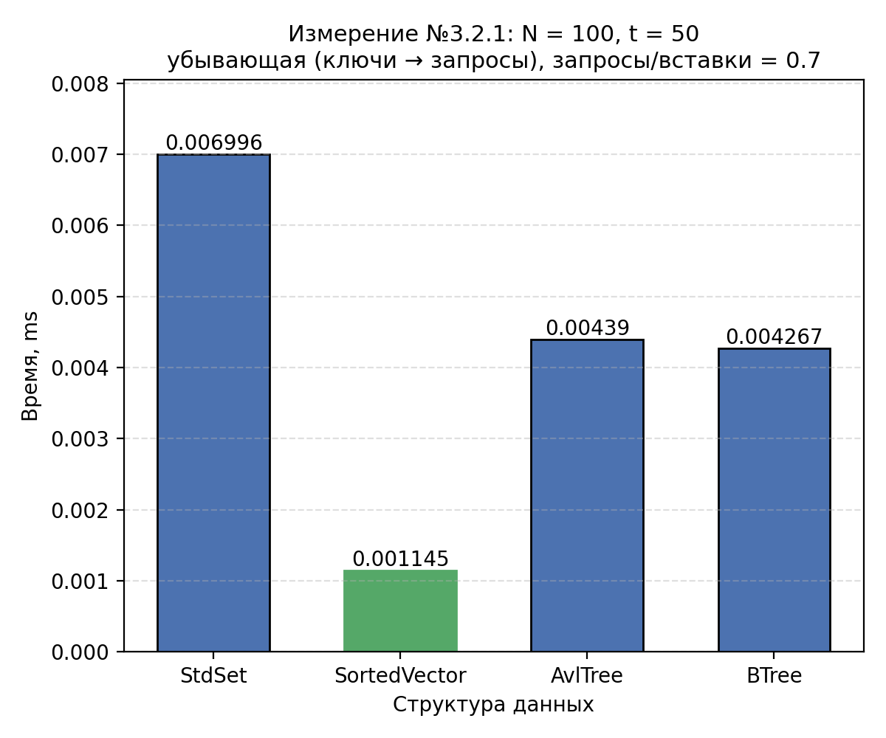

### Измерение №3.2.2

**Распределение:** убывающая последовательность, сначала все ключи, затем запросы

**$\frac{\text{число запросов}}{\text{число вставок}}$:** 0.7

**Уникальных ключей:** 10000

**Дубликатов:** 3 500

**Датасет:** ```research/datasets/data_3_2_2.txt```

| Реализация     | Time, ms | CPU, ms  | Итераций | Отн. времени (лучший = 1.00) |
|----------------|----------|----------|----------|------------------------------|
| StdSet       |     70.6 |     70.6 |       10 |                     293.18 |
| SortedVector | **0.241** | **0.241** | **2883** |                   **1.00** |
| AVL-tree     |     1.05 |     1.05 |      711 |                       4.36 |
| B-tree       |     1.32 |     1.32 |      540 |                       5.48 |

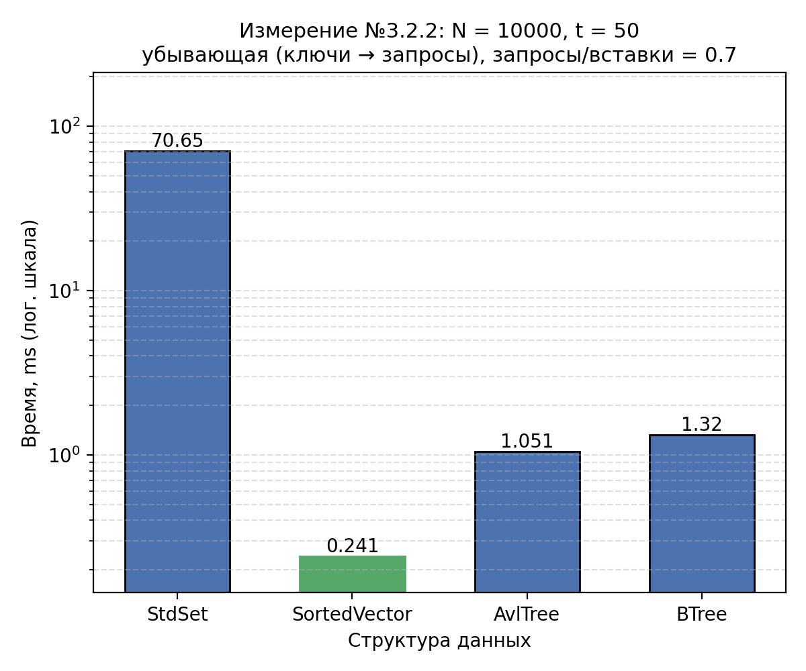

### Измерение №3.2.3

**Распределение:** убывающая последовательность, сначала все ключи, затем запросы

**$\frac{\text{число запросов}}{\text{число вставок}}$:** 0.7

**Уникальных ключей:** 1000000

**Дубликатов:** 350 000

**Датасет:** ```research/datasets/data_3_2_3.txt```

| Реализация     | Time, ms | CPU, ms  | Итераций | Отн. времени (лучший = 1.00) |
|----------------|----------|----------|----------|------------------------------|
| StdSet       |   740895 |   740895 |        1 |                      14924 |
| SortedVector | **49.6** | **49.6** |   **13** |                   **1.00** |
| AVL-tree     |      329 |      329 |        2 |                       6.63 |
| B-tree       |      304 |      304 |        2 |                       6.12 |

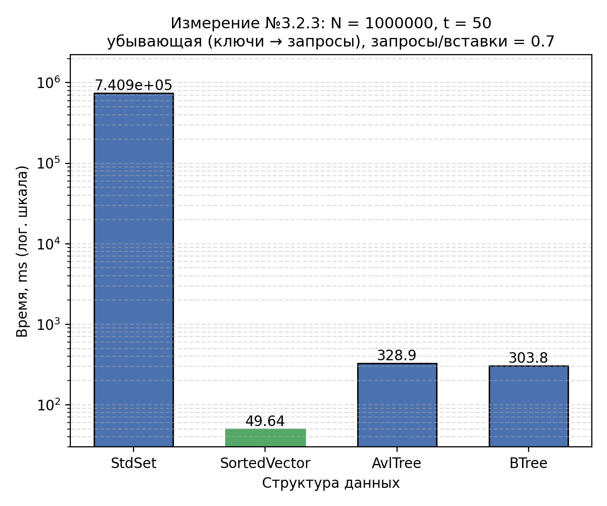

### Измерение №3.3.1

**Распределение:** убывающая последовательность, сначала все ключи, затем запросы

**$\frac{\text{число запросов}}{\text{число вставок}}$:** 1.0

**Уникальных ключей:** 100

**Дубликатов:** 35

**Датасет:** ```research/datasets/data_3_3_1.txt```

| Реализация     | Time, ms | CPU, ms  | Итераций | Отн. времени (лучший = 1.00) |
|----------------|----------|----------|----------|------------------------------|
| StdSet       | 0.008829 | 0.008825 |    78402 |                       6.34 |
| SortedVector | **0.001393** | **0.001391** | **511233** |                   **1.00** |
| AVL-tree     | 0.004831 |  0.00481 |   141809 |                       3.47 |
| B-tree       | 0.004852 | 0.004852 |   144832 |                       3.48 |

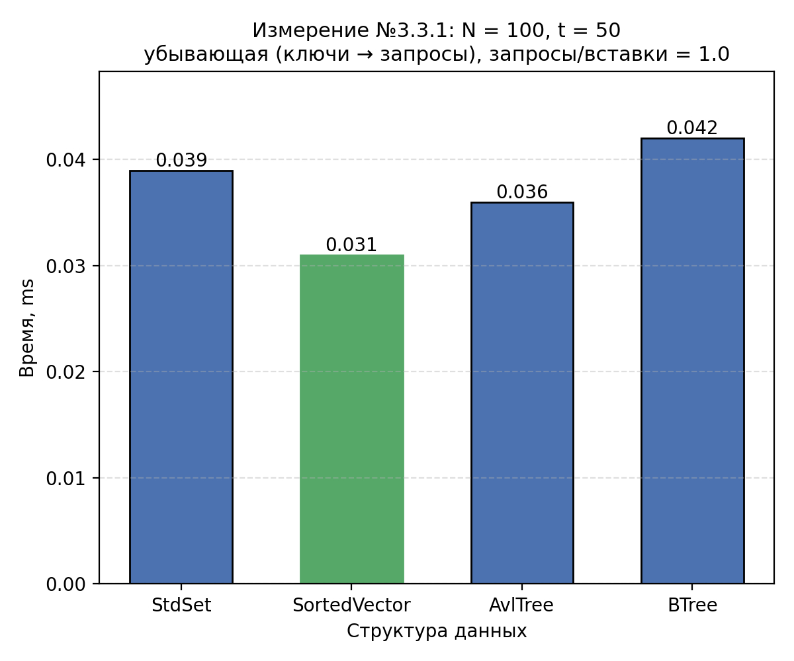

### Измерение №3.3.2

**Распределение:** убывающая последовательность, сначала все ключи, затем запросы

**$\frac{\text{число запросов}}{\text{число вставок}}$:** 1.0

**Уникальных ключей:** 10000

**Дубликатов:** 3 500

**Датасет:** ```research/datasets/data_3_3_2.txt```

| Реализация     | Time, ms | CPU, ms  | Итераций | Отн. времени (лучший = 1.00) |
|----------------|----------|----------|----------|------------------------------|
| StdSet       |      109 |      109 |        7 |                     337.92 |
| SortedVector | **0.322** | **0.321** | **2166** |                   **1.00** |
| AVL-tree     |     1.33 |     1.31 |      578 |                       4.14 |
| B-tree       |     1.55 |     1.55 |      451 |                       4.80 |

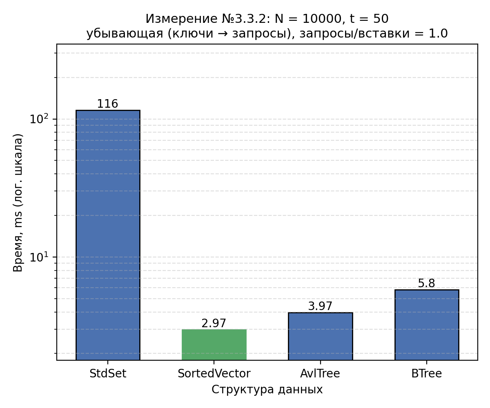

### Измерение №3.3.3

**Распределение:** убывающая последовательность, сначала все ключи, затем запросы

**$\frac{\text{число запросов}}{\text{число вставок}}$:** 1.0

**Уникальных ключей:** 1000000

**Дубликатов:** 350 000

**Датасет:** ```research/datasets/data_3_3_3.txt```

| Реализация     | Time, ms | CPU, ms  | Итераций | Отн. времени (лучший = 1.00) |
|----------------|----------|----------|----------|------------------------------|
| StdSet       |  1214069 |  1214069 |        1 |                      18159 |
| SortedVector | **66.9** | **66.9** |   **10** |                   **1.00** |
| AVL-tree     |      440 |      440 |        1 |                       6.58 |
| B-tree       |      362 |      362 |        2 |                       5.42 |

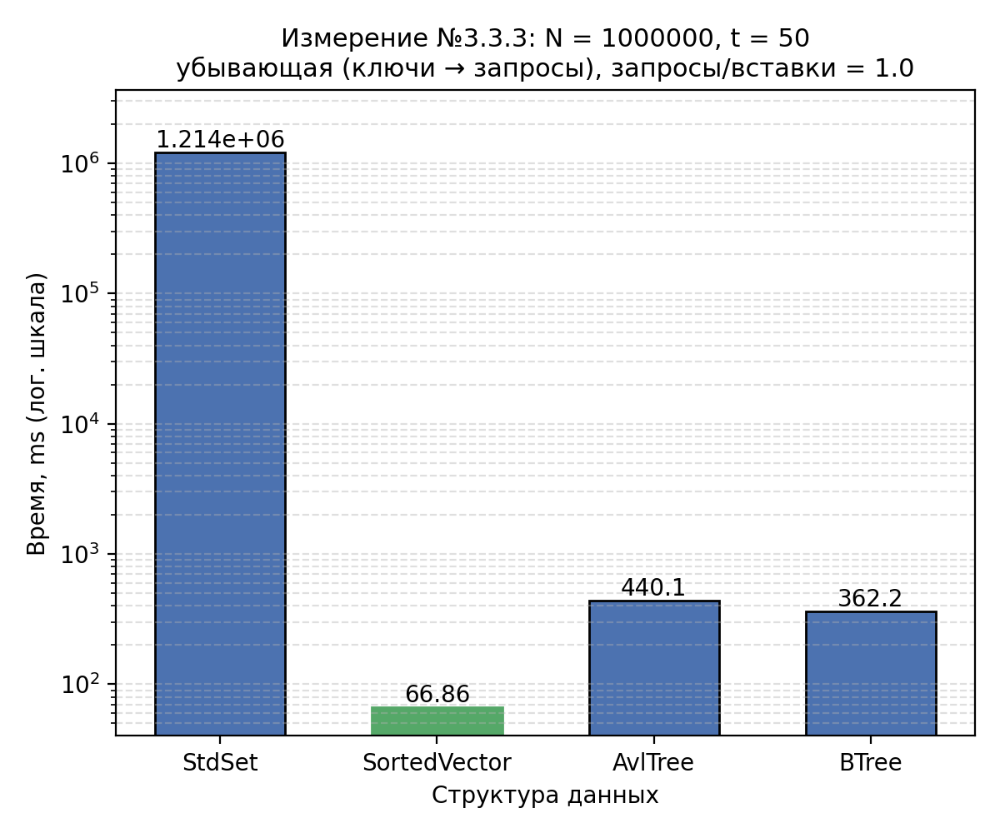

### Измерение №4.1.1

**Распределение:** убывающая последовательность, ключи и запросы равномерно перемешаны

**$\frac{\text{число запросов}}{\text{число вставок}}$:** 0.3

**Уникальных ключей:** 100

**Дубликатов:** 35

**Датасет:** ```research/datasets/data_4_1_1.txt```

| Реализация     | Time, ms | CPU, ms  | Итераций | Отн. времени (лучший = 1.00) |
|----------------|----------|----------|----------|------------------------------|
| StdSet       | 0.003123 | 0.003119 |   227196 |                       1.80 |
| SortedVector | **0.001733** | **0.001732** | **409711** |                   **1.00** |
| AVL-tree     |  0.00403 | 0.004027 |   173321 |                       2.33 |
| B-tree       | 0.003435 | 0.003435 |   200590 |                       1.98 |

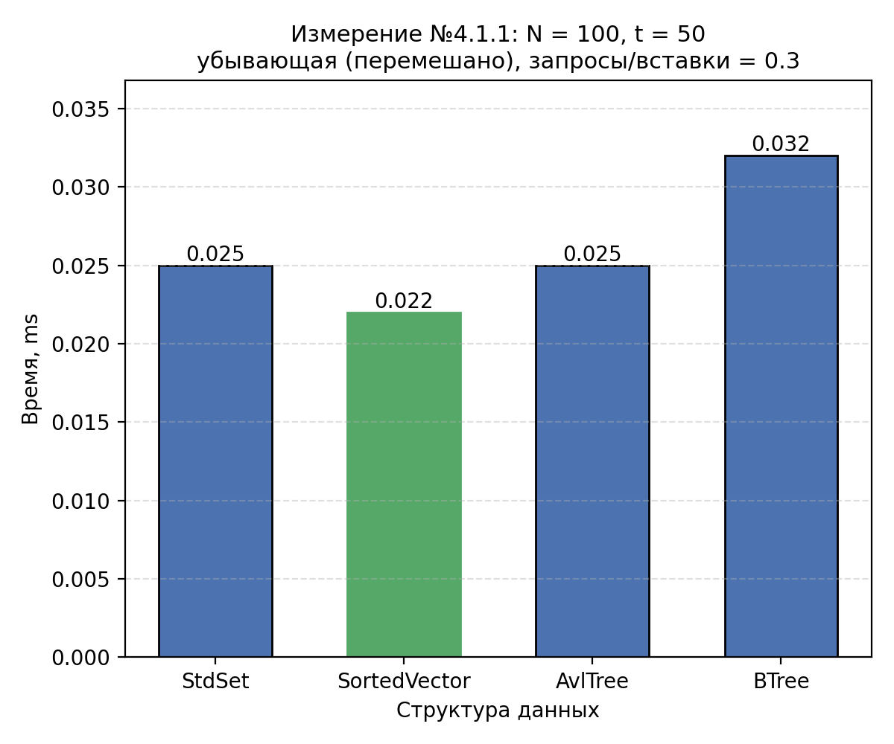

### Измерение №4.1.2

**Распределение:** убывающая последовательность, ключи и запросы равномерно перемешаны

**$\frac{\text{число запросов}}{\text{число вставок}}$:** 0.3

**Уникальных ключей:** 10000

**Дубликатов:** 3 500

**Датасет:** ```research/datasets/data_4_1_2.txt```

| Реализация     | Time, ms | CPU, ms  | Итераций | Отн. времени (лучший = 1.00) |
|----------------|----------|----------|----------|------------------------------|
| StdSet       |       13 |       13 |       57 |                      17.28 |
| SortedVector |     1.31 |     1.31 |      534 |                       1.75 |
| AVL-tree     | **0.75** | **0.75** |  **930** |                   **1.00** |
| B-tree       |    0.934 |    0.934 |      736 |                       1.25 |

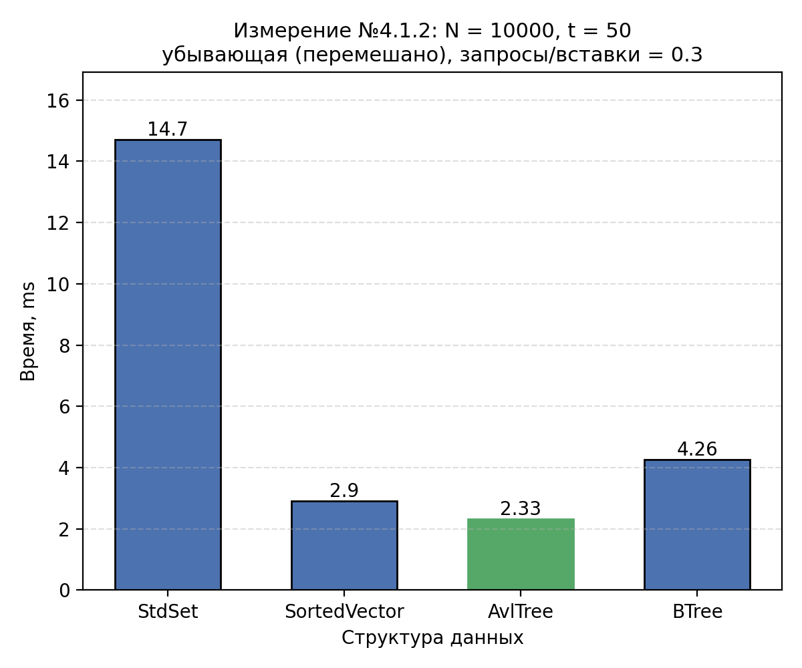

### Измерение №4.1.3

**Распределение:** убывающая последовательность, ключи и запросы равномерно перемешаны

**$\frac{\text{число запросов}}{\text{число вставок}}$:** 0.3

**Уникальных ключей:** 1000000

**Дубликатов:** 350 000

**Датасет:** ```research/datasets/data_4_1_3.txt```

| Реализация     | Time, ms | CPU, ms  | Итераций | Отн. времени (лучший = 1.00) |
|----------------|----------|----------|----------|------------------------------|
| StdSet       |   131478 |   131478 |        1 |                     780.48 |
| SortedVector |    23239 |    23239 |        1 |                     137.95 |
| AVL-tree     |  **168** |  **168** |    **4** |                   **1.00** |
| B-tree       |      212 |      212 |        3 |                       1.26 |

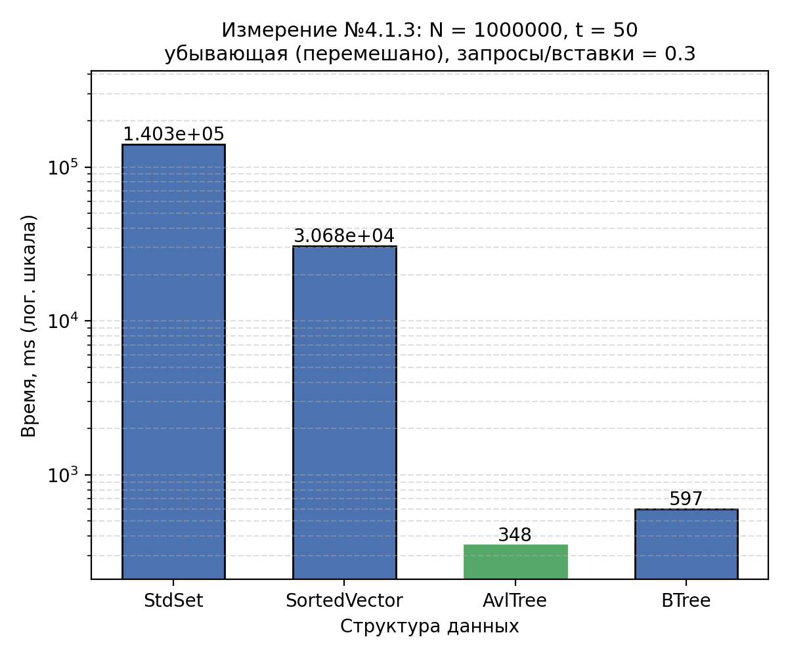

### Измерение №4.2.1

**Распределение:** убывающая последовательность, ключи и запросы равномерно перемешаны

**$\frac{\text{число запросов}}{\text{число вставок}}$:** 0.7

**Уникальных ключей:** 100

**Дубликатов:** 35

**Датасет:** ```research/datasets/data_4_2_1.txt```

| Реализация     | Time, ms | CPU, ms  | Итераций | Отн. времени (лучший = 1.00) |
|----------------|----------|----------|----------|------------------------------|
| StdSet       | 0.004654 | 0.004654 |   151233 |                       1.65 |
| SortedVector | **0.002826** | **0.002826** | **246259** |                   **1.00** |
| AVL-tree     | 0.004256 | 0.004255 |   163001 |                       1.51 |
| B-tree       | 0.004054 | 0.004054 |   172317 |                       1.43 |

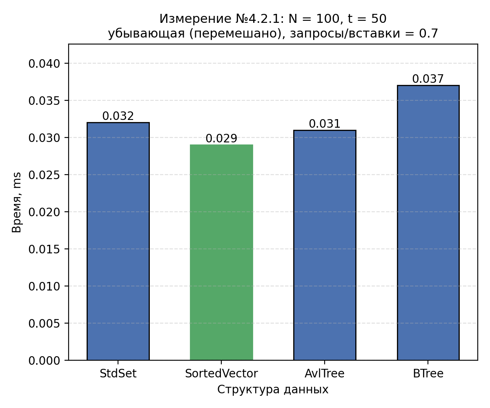

### Измерение №4.2.2

**Распределение:** убывающая последовательность, ключи и запросы равномерно перемешаны

**$\frac{\text{число запросов}}{\text{число вставок}}$:** 0.7

**Уникальных ключей:** 10000

**Дубликатов:** 3 500

**Датасет:** ```research/datasets/data_4_2_2.txt```

| Реализация     | Time, ms | CPU, ms  | Итераций | Отн. времени (лучший = 1.00) |
|----------------|----------|----------|----------|------------------------------|
| StdSet       |       31 |       31 |       23 |                      34.82 |
| SortedVector |     2.32 |     2.32 |      298 |                       2.61 |
| AVL-tree     | **0.89** | **0.89** |  **782** |                   **1.00** |
| B-tree       |     1.14 |     1.14 |      610 |                       1.28 |

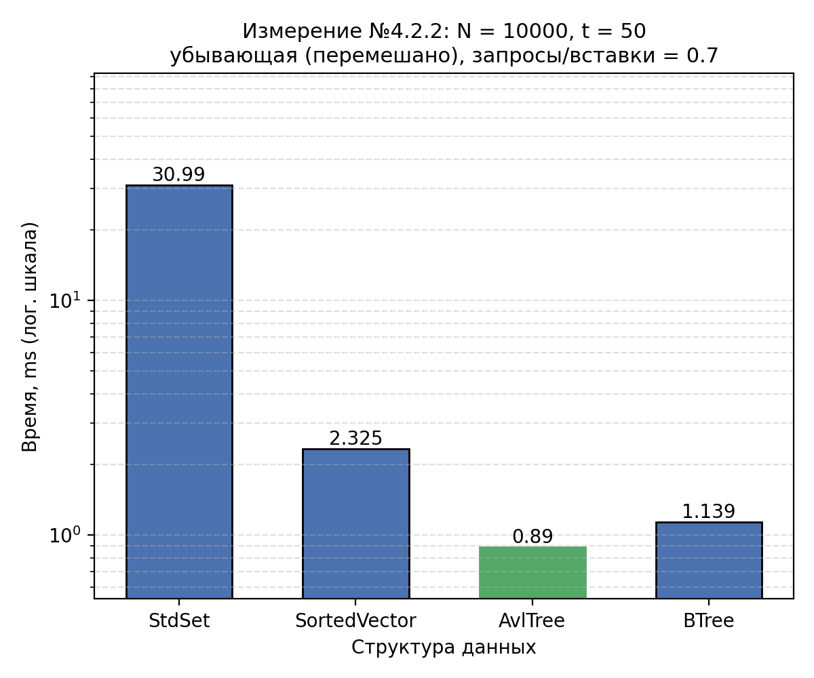

### Измерение №4.2.3

**Распределение:** убывающая последовательность, ключи и запросы равномерно перемешаны

**$\frac{\text{число запросов}}{\text{число вставок}}$:** 0.7

**Уникальных ключей:** 1000000

**Дубликатов:** 350 000

**Датасет:** ```research/datasets/data_4_2_3.txt```

| Реализация     | Time, ms | CPU, ms  | Итераций | Отн. времени (лучший = 1.00) |
|----------------|----------|----------|----------|------------------------------|
| StdSet       |   317564 |   317564 |        1 |                       1456 |
| SortedVector |    46427 |    46427 |        1 |                     212.79 |
| AVL-tree     |  **218** |  **218** |    **3** |                   **1.00** |
| B-tree       |      257 |      257 |        3 |                       1.18 |


### Измерение №4.3.1

**Распределение:** убывающая последовательность, ключи и запросы равномерно перемешаны

**$\frac{\text{число запросов}}{\text{число вставок}}$:** 1.0

**Уникальных ключей:** 100

**Дубликатов:** 35

**Датасет:** ```research/datasets/data_4_3_1.txt```

| Реализация     | Time, ms | CPU, ms  | Итераций | Отн. времени (лучший = 1.00) |
|----------------|----------|----------|----------|------------------------------|
| StdSet       | 0.005293 | 0.005293 |   134002 |                       1.71 |
| SortedVector | **0.003097** | **0.003097** | **227003** |                   **1.00** |
| AVL-tree     | 0.004505 | 0.004505 |   148160 |                       1.45 |
| B-tree       | 0.004131 | 0.004131 |   166919 |                       1.33 |

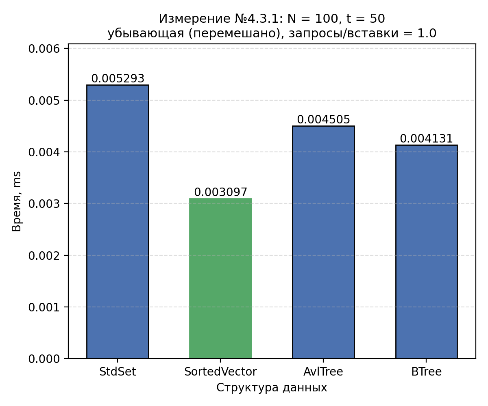

### Измерение №4.3.2

**Распределение:** убывающая последовательность, ключи и запросы равномерно перемешаны

**$\frac{\text{число запросов}}{\text{число вставок}}$:** 1.0

**Уникальных ключей:** 10000

**Дубликатов:** 3 500

**Датасет:** ```research/datasets/data_4_3_2.txt```

| Реализация     | Time, ms | CPU, ms  | Итераций | Отн. времени (лучший = 1.00) |
|----------------|----------|----------|----------|------------------------------|
| StdSet       |     40.8 |     40.8 |       17 |                      39.82 |
| SortedVector |     2.83 |     2.83 |      247 |                       2.76 |
| AVL-tree     | **1.03** | **1.03** |  **690** |                   **1.00** |
| B-tree       |     1.31 |     1.31 |      530 |                       1.28 |

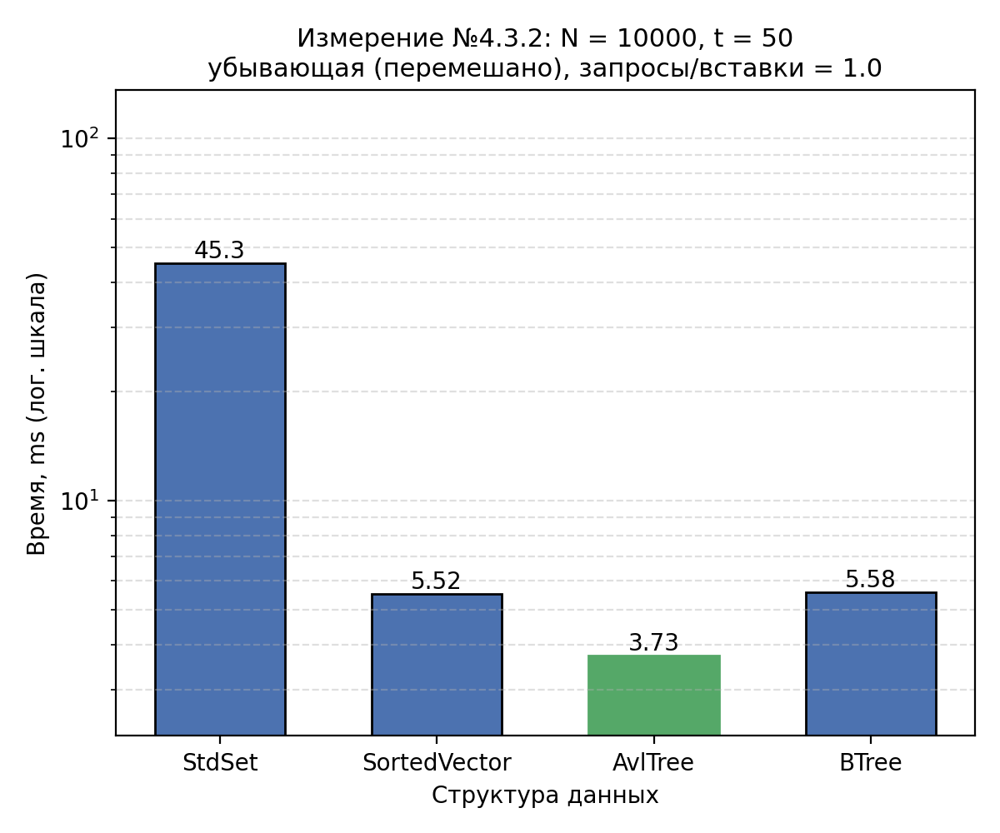

### Измерение №4.3.3

**Распределение:** убывающая последовательность, ключи и запросы равномерно перемешаны

**$\frac{\text{число запросов}}{\text{число вставок}}$:** 1.0

**Уникальных ключей:** 1000000

**Дубликатов:** 350 000

**Датасет:** ```research/datasets/data_4_3_3.txt```

| Реализация     | Time, ms | CPU, ms  | Итераций | Отн. времени (лучший = 1.00) |
|----------------|----------|----------|----------|------------------------------|
| StdSet       |   440456 |   440456 |        1 |                       1676 |
| SortedVector |    57389 |    57389 |        1 |                     218.38 |
| AVL-tree     |  **263** |  **263** |    **2** |                   **1.00** |
| B-tree       |      300 |      300 |        2 |                       1.14 |

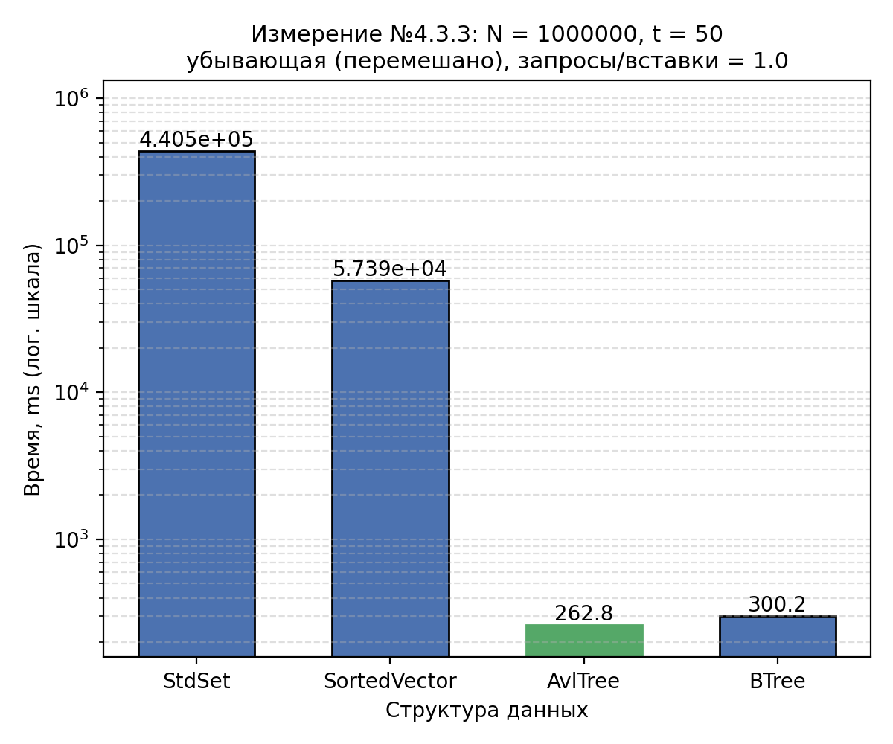

### Измерение №5.1.1

**Распределение:** случайное распределение, сначала все ключи, затем запросы

**$\frac{\text{число запросов}}{\text{число вставок}}$:** 0.3

**Уникальных ключей:** 100

**Дубликатов:** 35

**Датасет:** ```research/datasets/data_5_1_1.txt```

| Реализация     | Time, ms | CPU, ms  | Итераций | Отн. времени (лучший = 1.00) |
|----------------|----------|----------|----------|------------------------------|
| StdSet       | 0.004428 | 0.004428 |   153647 |                       3.99 |
| SortedVector | **0.00111** | **0.00111** | **622051** |                   **1.00** |
| AVL-tree     | 0.004171 | 0.004171 |   164487 |                       3.76 |
| B-tree       | 0.002532 | 0.002532 |   280034 |                       2.28 |

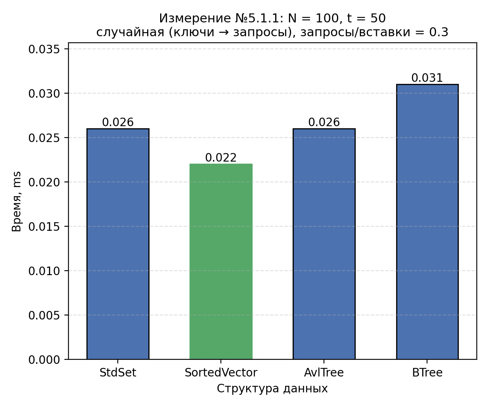

### Измерение №5.1.2

**Распределение:** случайное распределение, сначала все ключи, затем запросы

**$\frac{\text{число запросов}}{\text{число вставок}}$:** 0.3

**Уникальных ключей:** 10000

**Дубликатов:** 3 500

**Датасет:** ```research/datasets/data_5_1_2.txt```

| Реализация     | Time, ms | CPU, ms  | Итераций | Отн. времени (лучший = 1.00) |
|----------------|----------|----------|----------|------------------------------|
| StdSet       |     67.2 |     67.2 |       11 |                     380.04 |
| SortedVector | **0.177** | **0.176** | **3981** |                   **1.00** |
| AVL-tree     |     1.17 |     1.17 |      592 |                       6.62 |
| B-tree       |    0.787 |    0.787 |      888 |                       4.45 |

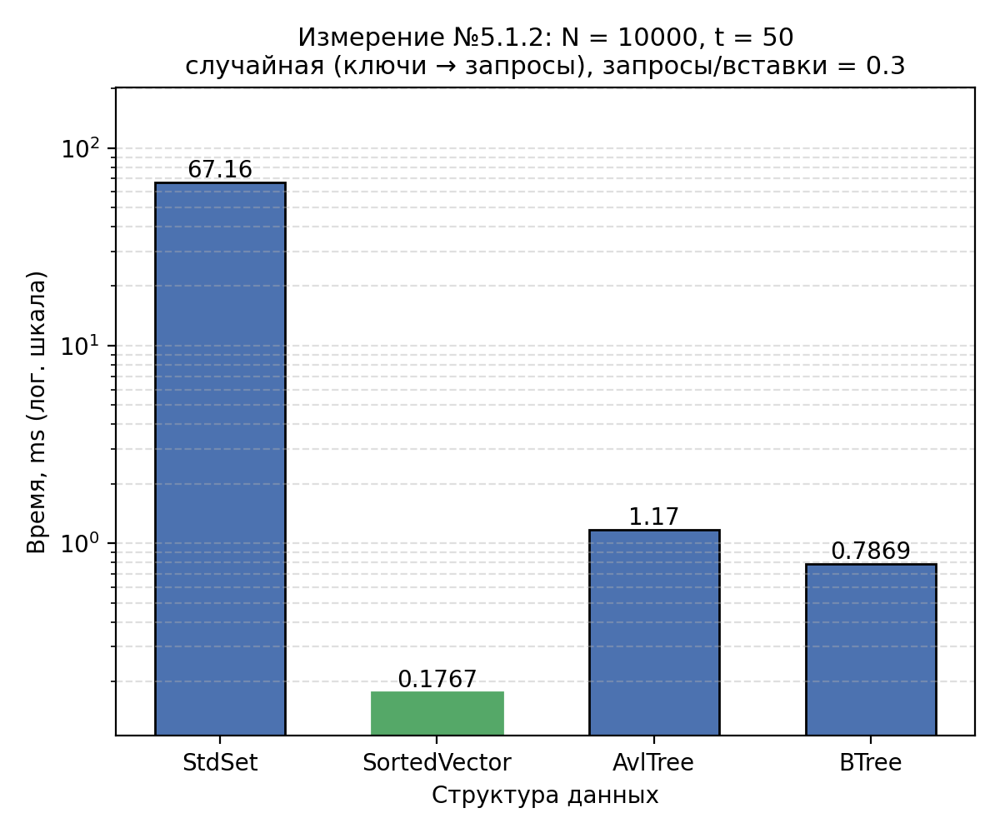

### Измерение №5.1.3

**Распределение:** случайное распределение, сначала все ключи, затем запросы

**$\frac{\text{число запросов}}{\text{число вставок}}$:** 0.3

**Уникальных ключей:** 1000000

**Дубликатов:** 350 000

**Датасет:** ```research/datasets/data_5_1_3.txt```

| Реализация     | Time, ms | CPU, ms  | Итераций | Отн. времени (лучший = 1.00) |
|----------------|----------|----------|----------|------------------------------|
| StdSet       |  3475933 |  3475933 |        1 |                     102907 |
| SortedVector | **33.8** | **33.8** |   **19** |                   **1.00** |
| AVL-tree     |      412 |      412 |        2 |                      12.19 |
| B-tree       |      181 |      181 |        4 |                       5.35 |

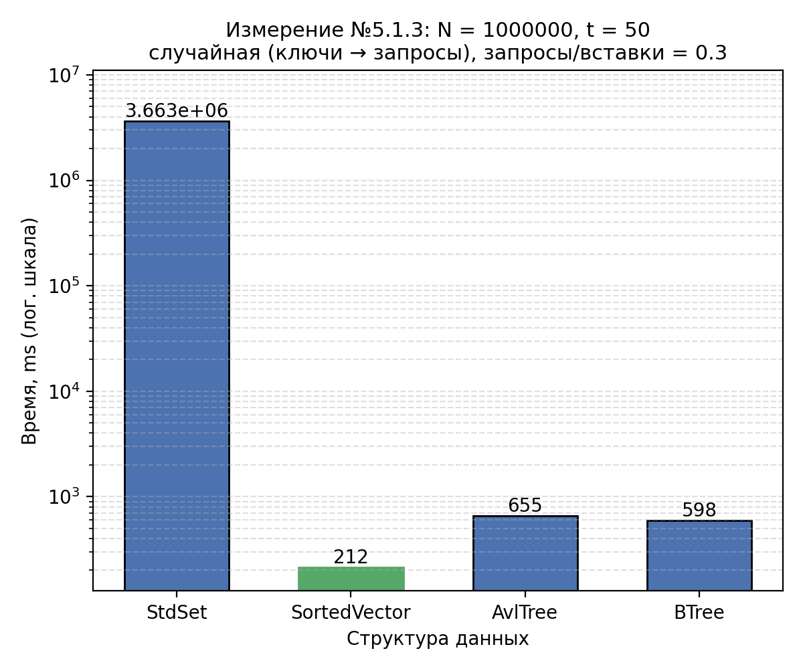

### Измерение №5.2.1

**Распределение:** случайное распределение, сначала все ключи, затем запросы

**$\frac{\text{число запросов}}{\text{число вставок}}$:** 0.7

**Уникальных ключей:** 100

**Дубликатов:** 35

**Датасет:** ```research/datasets/data_5_2_1.txt```

| Реализация     | Time, ms | CPU, ms  | Итераций | Отн. времени (лучший = 1.00) |
|----------------|----------|----------|----------|------------------------------|
| StdSet       | 0.007459 | 0.007457 |    95618 |                       5.42 |
| SortedVector | **0.001376** | **0.001376** | **498519** |                   **1.00** |
| AVL-tree     | 0.004542 | 0.004541 |   155958 |                       3.30 |
| B-tree       | 0.003292 | 0.003292 |   211936 |                       2.39 |

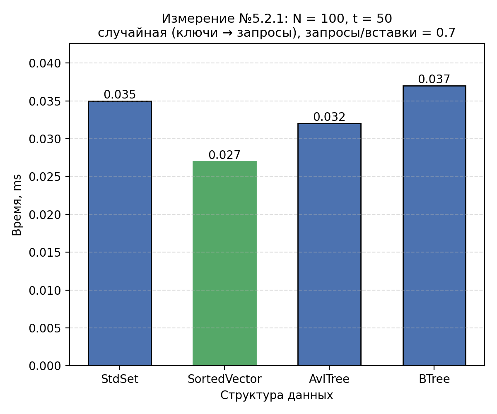

### Измерение №5.2.2

**Распределение:** случайное распределение, сначала все ключи, затем запросы

**$\frac{\text{число запросов}}{\text{число вставок}}$:** 0.7

**Уникальных ключей:** 10000

**Дубликатов:** 3 500

**Датасет:** ```research/datasets/data_5_2_2.txt```

| Реализация     | Time, ms | CPU, ms  | Итераций | Отн. времени (лучший = 1.00) |
|----------------|----------|----------|----------|------------------------------|
| StdSet       |      151 |      151 |        5 |                     533.66 |
| SortedVector | **0.284** | **0.283** | **2444** |                   **1.00** |
| AVL-tree     |     1.58 |     1.58 |      454 |                       5.58 |
| B-tree       |     1.11 |      1.1 |      629 |                       3.90 |

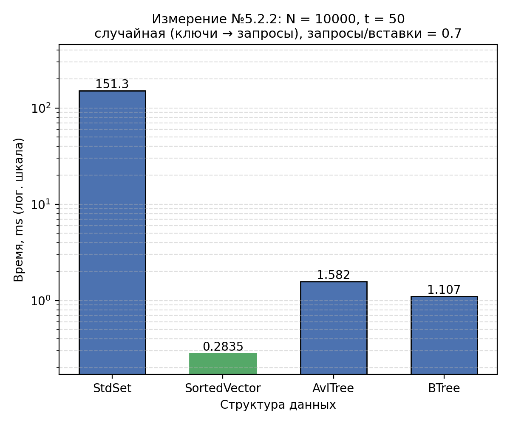

### Измерение №5.2.3

**Распределение:** случайное распределение, сначала все ключи, затем запросы

**$\frac{\text{число запросов}}{\text{число вставок}}$:** 0.7

**Уникальных ключей:** 1000000

**Дубликатов:** 350 000

**Датасет:** ```research/datasets/data_5_2_3.txt```

| Реализация     | Time, ms | CPU, ms  | Итераций | Отн. времени (лучший = 1.00) |
|----------------|----------|----------|----------|------------------------------|
| StdSet       |  8679112 |  8679112 |        1 |                     150438 |
| SortedVector | **57.7** | **57.7** |   **11** |                   **1.00** |
| AVL-tree     |      598 |      598 |        1 |                      10.36 |
| B-tree       |      260 |      260 |        2 |                       4.51 |

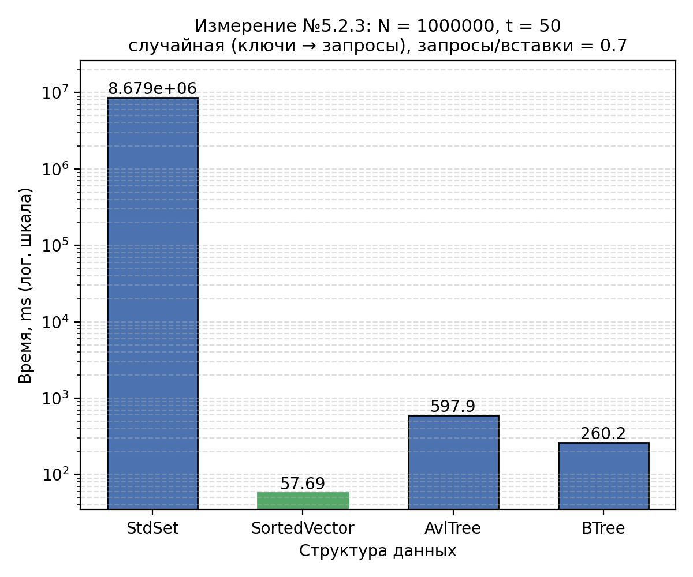

### Измерение №5.3.1

**Распределение:** случайное распределение, сначала все ключи, затем запросы

**$\frac{\text{число запросов}}{\text{число вставок}}$:** 1.0

**Уникальных ключей:** 100

**Дубликатов:** 35

**Датасет:** ```research/datasets/data_5_3_1.txt```

| Реализация     | Time, ms | CPU, ms  | Итераций | Отн. времени (лучший = 1.00) |
|----------------|----------|----------|----------|------------------------------|
| StdSet       | 0.009573 |  0.00957 |    73535 |                       5.79 |
| SortedVector | **0.001652** | **0.001632** | **437303** |                   **1.00** |
| AVL-tree     | 0.004682 | 0.004682 |   147360 |                       2.83 |
| B-tree       | 0.003686 | 0.003672 |   189735 |                       2.23 |

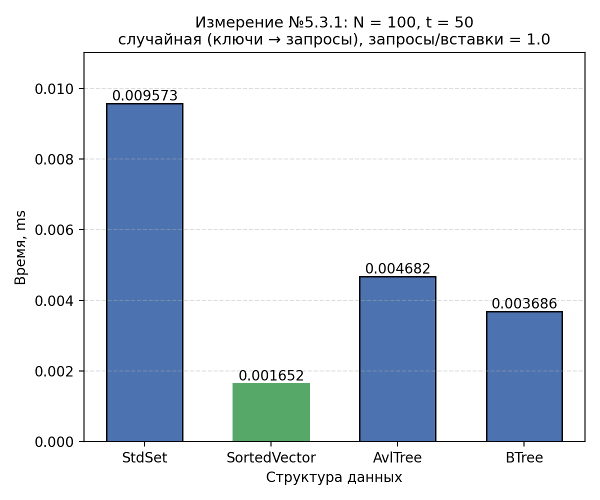

### Измерение №5.3.2

**Распределение:** случайное распределение, сначала все ключи, затем запросы

**$\frac{\text{число запросов}}{\text{число вставок}}$:** 1.0

**Уникальных ключей:** 10000

**Дубликатов:** 3 500

**Датасет:** ```research/datasets/data_5_3_2.txt```

| Реализация     | Time, ms | CPU, ms  | Итераций | Отн. времени (лучший = 1.00) |
|----------------|----------|----------|----------|------------------------------|
| StdSet       |      220 |      220 |        3 |                     584.38 |
| SortedVector | **0.376** | **0.376** | **1858** |                   **1.00** |
| AVL-tree     |     1.78 |     1.78 |      366 |                       4.73 |
| B-tree       |     1.33 |     1.33 |      523 |                       3.55 |

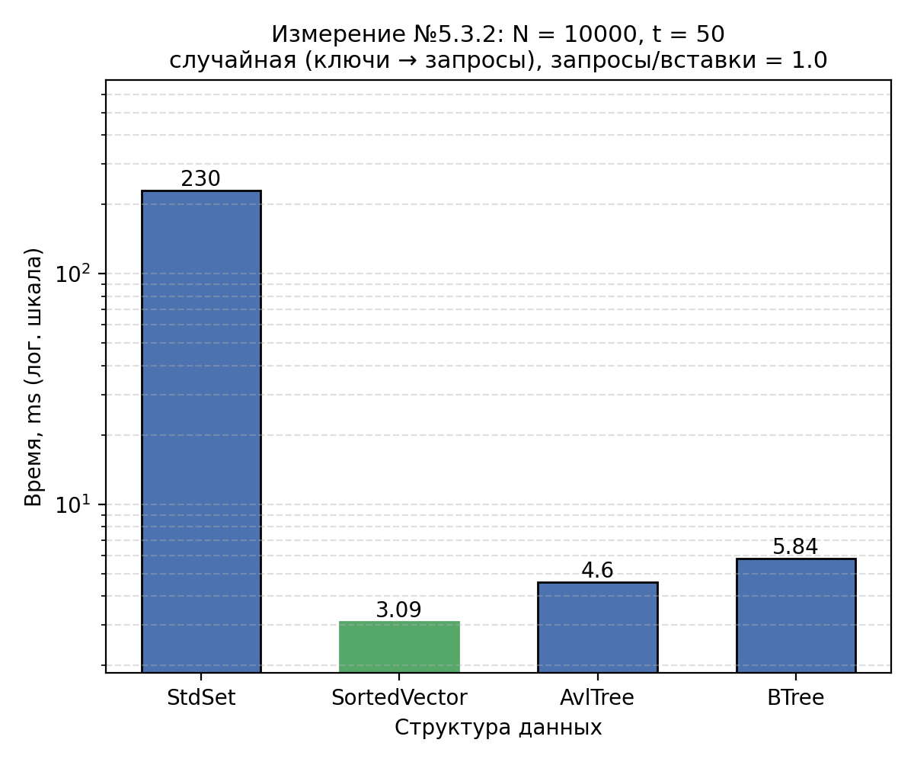

### Измерение №5.3.3

**Распределение:** случайное распределение, сначала все ключи, затем запросы

**$\frac{\text{число запросов}}{\text{число вставок}}$:** 1.0

**Уникальных ключей:** 1000000

**Дубликатов:** 350 000

**Датасет:** ```research/datasets/data_5_3_3.txt```

| Реализация     | Time, ms | CPU, ms  | Итераций | Отн. времени (лучший = 1.00) |
|----------------|----------|----------|----------|------------------------------|
| StdSet       | 11418971 | 11418971 |        1 |                     148708 |
| SortedVector | **76.8** | **76.8** |    **8** |                   **1.00** |
| AVL-tree     |      648 |      648 |        1 |                       8.44 |
| B-tree       |      314 |      314 |        2 |                       4.09 |

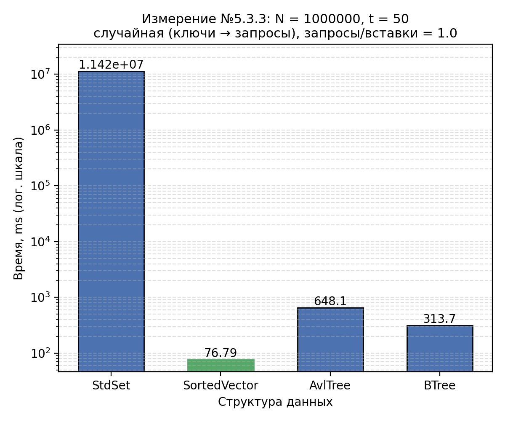

### Измерение №6.1.1

**Распределение:** случайное распределение, ключи и запросы равномерно перемешаны

**$\frac{\text{число запросов}}{\text{число вставок}}$:** 0.3

**Уникальных ключей:** 100

**Дубликатов:** 35

**Датасет:** ```research/datasets/data_6_1_1.txt```

| Реализация     | Time, ms | CPU, ms  | Итераций | Отн. времени (лучший = 1.00) |
|----------------|----------|----------|----------|------------------------------|
| StdSet       | 0.003342 | 0.003342 |   201892 |                       1.33 |
| SortedVector | 0.003499 | 0.003499 |   201957 |                       1.39 |
| AVL-tree     |  0.00415 |  0.00415 |   166427 |                       1.65 |
| B-tree       | **0.002521** | **0.002521** | **278377** |                   **1.00** |

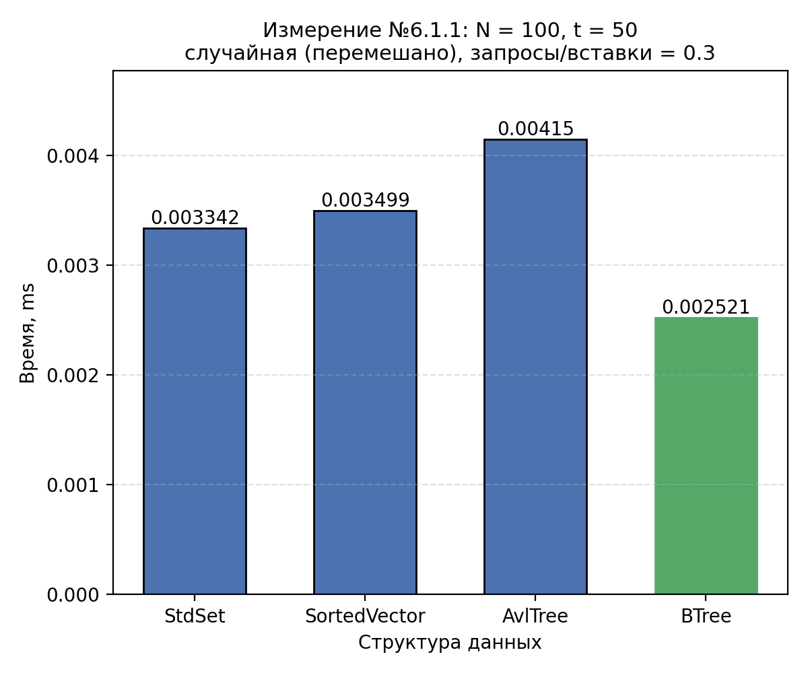

### Измерение №6.1.2

**Распределение:** случайное распределение, ключи и запросы равномерно перемешаны

**$\frac{\text{число запросов}}{\text{число вставок}}$:** 0.3

**Уникальных ключей:** 10000

**Дубликатов:** 3 500

**Датасет:** ```research/datasets/data_6_1_2.txt```

| Реализация     | Time, ms | CPU, ms  | Итераций | Отн. времени (лучший = 1.00) |
|----------------|----------|----------|----------|------------------------------|
| StdSet       |     29.6 |     28.5 |       26 |                      39.48 |
| SortedVector |     17.3 |     17.3 |       40 |                      22.98 |
| AVL-tree     |     1.26 |     1.24 |      583 |                       1.68 |
| B-tree       | **0.751** | **0.751** |  **899** |                   **1.00** |

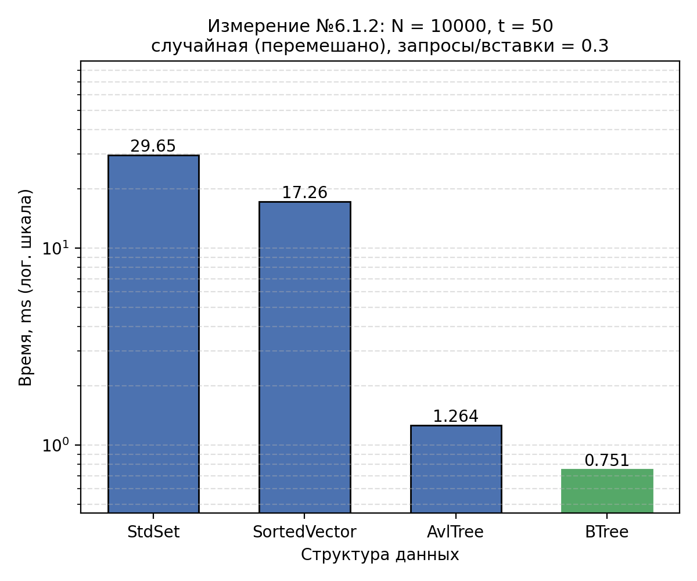

### Измерение №6.1.3

**Распределение:** случайное распределение, ключи и запросы равномерно перемешаны

**$\frac{\text{число запросов}}{\text{число вставок}}$:** 0.3

**Уникальных ключей:** 1000000

**Дубликатов:** 350 000

**Датасет:** ```research/datasets/data_6_1_3.txt```

| Реализация     | Time, ms | CPU, ms  | Итераций | Отн. времени (лучший = 1.00) |
|----------------|----------|----------|----------|------------------------------|
| StdSet       |  1534510 |  1534510 |        1 |                       9488 |
| SortedVector |   117174 |   117174 |        1 |                     724.51 |
| AVL-tree     |      414 |      414 |        2 |                       2.56 |
| B-tree       |  **162** |  **162** |    **4** |                   **1.00** |


### Измерение №6.2.1

**Распределение:** случайное распределение, ключи и запросы равномерно перемешаны

**$\frac{\text{число запросов}}{\text{число вставок}}$:** 0.7

**Уникальных ключей:** 100

**Дубликатов:** 35

**Датасет:** ```research/datasets/data_6_2_1.txt```

| Реализация     | Time, ms | CPU, ms  | Итераций | Отн. времени (лучший = 1.00) |
|----------------|----------|----------|----------|------------------------------|
| StdSet       | 0.005051 | 0.005051 |   138444 |                       1.67 |
| SortedVector | 0.005456 | 0.005456 |   127518 |                       1.80 |
| AVL-tree     | 0.004536 | 0.004535 |   154260 |                       1.50 |
| B-tree       | **0.003027** | **0.003021** | **230178** |                   **1.00** |


### Измерение №6.2.2

**Распределение:** случайное распределение, ключи и запросы равномерно перемешаны

**$\frac{\text{число запросов}}{\text{число вставок}}$:** 0.7

**Уникальных ключей:** 10000

**Дубликатов:** 3 500

**Датасет:** ```research/datasets/data_6_2_2.txt```

| Реализация     | Time, ms | CPU, ms  | Итераций | Отн. времени (лучший = 1.00) |
|----------------|----------|----------|----------|------------------------------|
| StdSet       |     58.8 |     58.8 |       12 |                      56.69 |
| SortedVector |     25.8 |     25.8 |       27 |                      24.85 |
| AVL-tree     |     1.56 |     1.56 |      444 |                       1.50 |
| B-tree       | **1.04** | **1.04** |  **669** |                   **1.00** |


### Измерение №6.2.3

**Распределение:** случайное распределение, ключи и запросы равномерно перемешаны

**$\frac{\text{число запросов}}{\text{число вставок}}$:** 0.7

**Уникальных ключей:** 1000000

**Дубликатов:** 350 000

**Датасет:** ```research/datasets/data_6_2_3.txt```

| Реализация     | Time, ms | CPU, ms  | Итераций | Отн. времени (лучший = 1.00) |
|----------------|----------|----------|----------|------------------------------|
| StdSet       |  3372365 |  3372365 |        1 |                      13577 |
| SortedVector |   201477 |   201477 |        1 |                     811.11 |
| AVL-tree     |      522 |      522 |        1 |                       2.10 |
| B-tree       |  **248** |  **248** |    **3** |                   **1.00** |


### Измерение №6.3.1

**Распределение:** случайное распределение, ключи и запросы равномерно перемешаны

**$\frac{\text{число запросов}}{\text{число вставок}}$:** 1.0

**Уникальных ключей:** 100

**Дубликатов:** 35

**Датасет:** ```research/datasets/data_6_3_1.txt```

| Реализация     | Time, ms | CPU, ms  | Итераций | Отн. времени (лучший = 1.00) |
|----------------|----------|----------|----------|------------------------------|
| StdSet       | 0.005603 | 0.005603 |   125217 |                       1.63 |
| SortedVector | 0.006541 | 0.006541 |   106856 |                       1.90 |
| AVL-tree     |  0.00483 |  0.00483 |   145520 |                       1.41 |
| B-tree       | **0.003437** | **0.003437** | **202860** |                   **1.00** |


### Измерение №6.3.2

**Распределение:** случайное распределение, ключи и запросы равномерно перемешаны

**$\frac{\text{число запросов}}{\text{число вставок}}$:** 1.0

**Уникальных ключей:** 10000

**Дубликатов:** 3 500

**Датасет:** ```research/datasets/data_6_3_2.txt```

| Реализация     | Time, ms | CPU, ms  | Итераций | Отн. времени (лучший = 1.00) |
|----------------|----------|----------|----------|------------------------------|
| StdSet       |     82.9 |     82.9 |        8 |                      66.69 |
| SortedVector |     27.2 |     27.2 |       26 |                      21.90 |
| AVL-tree     |     1.78 |     1.78 |      380 |                       1.43 |
| B-tree       | **1.24** | **1.24** |  **564** |                   **1.00** |


### Измерение №6.3.3

**Распределение:** случайное распределение, ключи и запросы равномерно перемешаны

**$\frac{\text{число запросов}}{\text{число вставок}}$:** 1.0

**Уникальных ключей:** 1000000

**Дубликатов:** 350 000

**Датасет:** ```research/datasets/data_6_3_3.txt```

| Реализация     | Time, ms | CPU, ms  | Итераций | Отн. времени (лучший = 1.00) |
|----------------|----------|----------|----------|------------------------------|
| StdSet       |  4304249 |  4304249 |        1 |                      14399 |
| SortedVector |   226956 |   226956 |        1 |                     759.24 |
| AVL-tree     |      602 |      602 |        1 |                       2.02 |
| B-tree       |  **299** |  **299** |    **2** |                   **1.00** |


