# Исследование реализаций динамического множества целых ключей с запросами.


## Цель работы.

Исследовать модель запросов на множестве целых ключей, реализованную на различных
структурах данных:
- std::set
- упорядоченный std::vector
- дополненное AVL - дерево
- B - дерево

## Обозначения

R = $\frac{\text{число запросов}}{\text{число вставок}}$

## Методика измерений

Для выявления преимуществ одной структуры данных над другой в ходе исследования изменялись следующие параметры:

* Размер множеств
* Отношение R
* функция распределения ключей

На каждый эксперимент проводится измерение времени, в течении которого получается
результат обработки последовательности запросов.

Для измерения зависимости скорости обработки от величины R рассматриваются три соотношения:

**(1.1)** R = 3/7

**(1.2)** R = 1

**(1.3)** R = 7/3

Доля каждого из запросов q, m и n составляет $\frac{1}{3}$ от общего числа запросов.

В качестве размеров множеств были выбраны следующе: ```100, 10000, 1000000``` (шаг - множитель 100).
Для нахождения зависимости от размера множества ```N``` выполнялись запросы, количество которых определялось из соотношений `(1.1)` - `(1.3)`, причем для разных
структур данных, с одинаковой мощностью множества ключей, используется одна и та же последовательность запросов.

В качестве последовательности входных данных были выбраны следующие распределения ключей:

| Порядок подачи            | возрастание значений ключей | убывание значений ключей | случайный значения|
|---------------------------|:-----------:|:--------:|:---------:|
| сначала вставки, потом запросы | 1           | 3        | 5         |
| равномерное перемешивание вставок и запросов | 2           | 4        | 6         |

Каждое распределение образуется из сочетания порядка подачи (строки) и характера распределения значений ключей (столбцы).
В таблице указаны номера распределений, которые входят в имена датасетов ```data_{распределение}_{отношение}_{N}.txt```.

В каждой из последовательностей входных данных будут присутствовать дубликаты. Их доля от N задана и постоянна - ```35%```

Отличительной особенностью B - дерева является то, что оно имеет свой внутренний параметр - степень дерева.
В основной части эксперимента будет выбрано значение ```t = 50```, а в дополнении к исследованию
будет приложена зависимость скорости обработки запросов B - дерева от t.

Для каждого множества ключей мощностью N выборка будет идти из диапазона [-0.5N, 0.5N].

## Конфигурация ПК

OS: macOS Sequoia 15.6

CPU: Apple M4

Компилятор: clang version 23.1.0

## Асимптотики реализаций

`N` — число ключей в множестве, `k` — число ключей в `(l, r]`, `t` — степень B-дерева.

<table>
  <thead>
    <tr>
      <th rowspan="2">Операция</th>
      <th rowspan="2"><code>std::set</code></th>
      <th colspan="2">Упорядоченный <code>std::vector</code></th>
      <th rowspan="2">AVL-дерево</th>
      <th rowspan="2">B-дерево</th>
    </tr>
    <tr>
      <th>лучший случай</th>
      <th>худший случай</th>
    </tr>
  </thead>
  <tbody>
    <tr>
      <td><code>k x</code> — вставка</td>
      <td><code>O(log N)</code></td>
      <td><code>O(1)</code></td>
      <td rowspan="4"><code>O(N * log N)</code></td>
      <td rowspan="4"><code>O(log N)</code></td>
      <td rowspan="4"><code>O(t · log_t N)</code></td>
    </tr>
    <tr>
      <td><code>q l r</code> — число ключей в <code>(l, r]</code></td>
      <td><code>O(C_1 * log(N) + C_2 * k)</code>, худший случай <code>O(N)</code></td>
      <td><code>O(log N)</code></td>
    </tr>
    <tr>
      <td><code>m i</code> — i-й наименьший ключ</td>
      <td><code>O(N)</code></td>
      <td><code>O(1)</code></td>
    </tr>
    <tr>
      <td><code>n x</code> — число ключей меньше <code>x</code></td>
      <td><code>O(N)</code></td>
      <td><code>O(log N)</code></td>
    </tr>
  </tbody>
</table>

## Ход работы

Подготовлены скрипт для генерации 54 различных последовательностей входных данных.
Написан генератор бенчмарков для измерения скорости работы алгоритмов на разных датасетах.
Затем отдельно построена зависимость скорости работы B - дерева от степени ```t```.

## Результаты

Путем усреднения всех результатов по времени получим гистограмму:

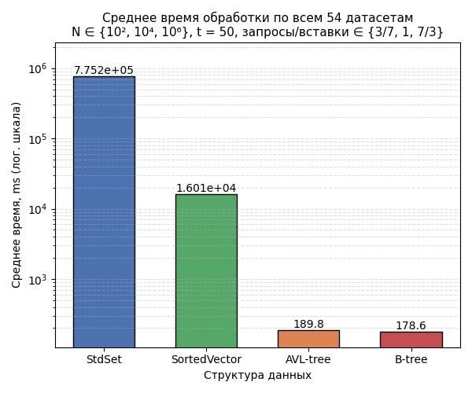

> Различия для четырех структур данных на всех 54 - eх датасетах приложены
> в виде гистограмм в разделе "Приложение"

### std::set

При небольшом количестве вставляемых ключей (N ~ 10<sup>0</sup> - 10<sup>2</sup>) показывает
относительно неплохие временные результаты, но является самым медленным алгоритмом среди исследуемых при N > 10<sup>4</sup> ввиду линейной асимптотики при некоторых типах запросов. При N ~ 10<sup>6</sup> обработка входных данных занимает длительно время: порядка ```3 часов```. Границы применимости: 10<sup>0</sup> < N < 10<sup>4</sup>.

### упорядоченный std::vector

Является лучшей структурой данных в случае, когда сначала идет заполнение
множества ключей, а затем последовательные обращения к нему. Максимальное время ожидания исполнения всей последовательности
запросов порядка ```4 минут```. Имеет более низкие показатели на распределениях, где вставка и запросы чередуются.
Обоснованием этому является сортировка и слияние при каждом запросе.
Время работы пропорционально соотношению **R**.

### avl - tree

Максимальное время ожидания исполнения всей последовательности
запросов порядка ```1 секунды```. Особенно выделяется по сравнению с ```std::vector``` и ```std::set``` при работе с распределениям типа, когда вставки и запросы равномерно распределены во входной последовательности. Однако временные показатели чуть больше временных показателей B - дерева. Это связано с постоянным промахом по кешу при обходе дерева.

### b - tree

Максимальное время ожидания исполнения всей
последовательности запросов порядка ```1 секунды```. Имеет лучшие показатели при работе большими объемами данных и занимает 1 - ое место на распределениях, в которых вставки и запросы чередуются во входной последовательности. Имеет варьирующийся параметр - степень t.

### Зависимость времени от степени B - дерева

Зависимость построим на одном конкретном примере. Основное
предназначенье B - деревьев это работа с большим объемом данных и
с медленной память. Поэтому для наблюдения зависимости рассмотрим следующий набор:

**Распределение:** случайное распределение, ключи и запросы равномерно перемешаны.

**R:** 3/7

**Уникальных ключей:** 1000000

**Дубликатов:** 350 000

**Датасет:** ```research/datasets/data_6_1_3.txt```

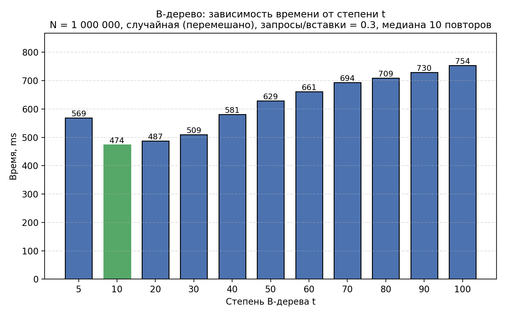

## Заключение

На входных данных, в которых сначала идет заполнение (вставка ключей), а затем запросы
ко множеству, лучшие показатели имеет ```упорядоченный std::vector```.

```Avl - дерево``` занимает первое и второе места в списке структур данных для поиска в случае, когда вставка ключей и
запросы распределены равномерно (равномерное чередовение).

```B - дерево``` занимает первое место среди исследуемых структур для поиска
при больших объемах данных (N ~ 10<sup>6</sup>) и чередовании вставок с запросами. Для B - дерева получена зависимость
времени работы от степени дерева: при ```5 < t < 20``` видим нисходящий тренд. Это
связано с тем, что при слишком малых t дерево начинает увеличиваться по высоте и быть слабо
отличимым от бинарных деревьев. При ```t > 30``` наблюдается восходящий тренд с небольшими флактуациями. Это объясняется
ростом линейного поиска внутри одного узла. Минимальное значение времени достигается при ```t = 30```.

```std::set``` проигрывает остальным алгоритмам ввиду того,
что выполнение запросов в конечном счете сводится к линейному перебору, в то время как у других
алгоритмов ($\log N$) и быстрее.

## Воспроизводимость

Запустить генерацию входных данных можно с помощью файлов генераторов, находящихся в
папке research/generators. Пример запуска из корня проекта:

```bash
python3 research/generators/generate_dataset.py gen 1 1 1
```

Создание гистограмм при запуске из корня проекта:

```bash
python3 research/generators/generate_dataset.py gen 1 1 1 --mode plot --json results.json
```

## Приложение

### Измерение №1.1.1

**Распределение:** возрастающая последовательность, сначала все ключи, затем запросы

**R:** 3/7

**Уникальных ключей:** 100

**Дубликатов:** 35

**Датасет:** ```research/datasets/data_1_1_1.txt```

| Реализация   | Time, ms  | CPU, ms   | Отн. времени (лучший = 1.00) |
|--------------|-----------|-----------|------------------------------|
| StdSet       |     0.005 |     0.005 |                         5.00 |
| SortedVector | **0.001** | **0.001** |                     **1.00** |
| AVL-tree     |     0.005 |     0.005 |                         5.00 |
| B-tree       |     0.002 |     0.002 |                         2.00 |

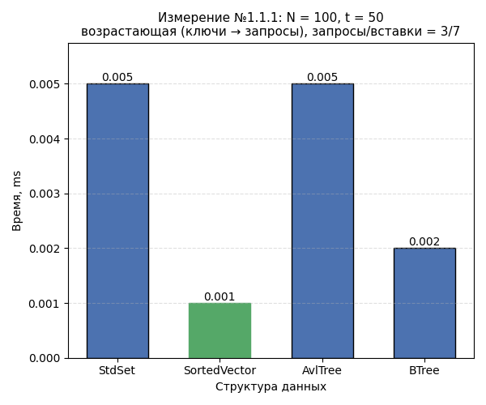

### Измерение №1.1.2

**Распределение:** возрастающая последовательность, сначала все ключи, затем запросы

**R:** 3/7

**Уникальных ключей:** 10000

**Дубликатов:** 3 500

**Датасет:** ```research/datasets/data_1_1_2.txt```

| Реализация   | Time, ms  | CPU, ms   | Отн. времени (лучший = 1.00) |
|--------------|-----------|-----------|------------------------------|
| StdSet       |      45.3 |      45.3 |                       383.90 |
| SortedVector | **0.118** | **0.118** |                     **1.00** |
| AVL-tree     |     0.901 |     0.901 |                         7.64 |
| B-tree       |     0.553 |     0.553 |                         4.69 |

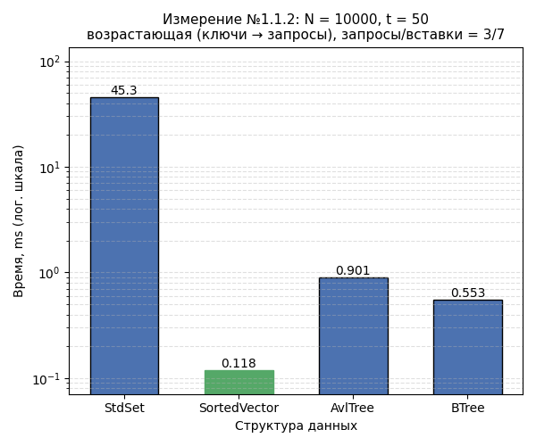

### Измерение №1.1.3

**Распределение:** возрастающая последовательность, сначала все ключи, затем запросы

**R:** 3/7

**Уникальных ключей:** 1000000

**Дубликатов:** 350 000

**Датасет:** ```research/datasets/data_1_1_3.txt```

| Реализация   | Time, ms  | CPU, ms   | Отн. времени (лучший = 1.00) |
|--------------|-----------|-----------|------------------------------|
| StdSet       | 4.104e+05 | 4.104e+05 |                     29475.58 |
| SortedVector | **13.92** | **13.92** |                     **1.00** |
| AVL-tree     |     162.4 |     162.4 |                        11.66 |
| B-tree       |     152.9 |     152.9 |                        10.98 |

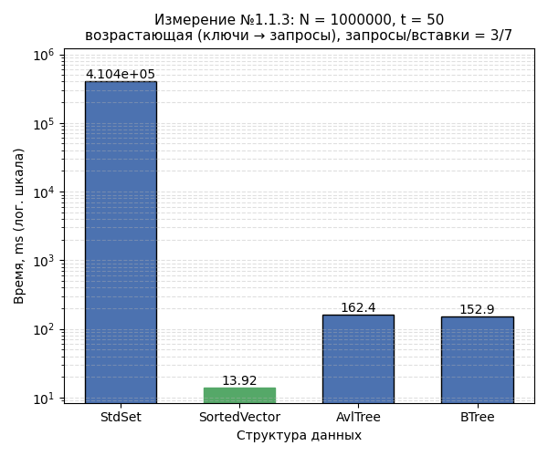

### Измерение №1.2.1

**Распределение:** возрастающая последовательность, сначала все ключи, затем запросы

**R:** 1

**Уникальных ключей:** 100

**Дубликатов:** 35

**Датасет:** ```research/datasets/data_1_2_1.txt```

| Реализация   | Time, ms  | CPU, ms   | Отн. времени (лучший = 1.00) |
|--------------|-----------|-----------|------------------------------|
| StdSet       |     0.009 |     0.009 |                         9.00 |
| SortedVector | **0.001** | **0.001** |                     **1.00** |
| AVL-tree     |     0.005 |     0.005 |                         5.00 |
| B-tree       |     0.002 |     0.002 |                         2.00 |

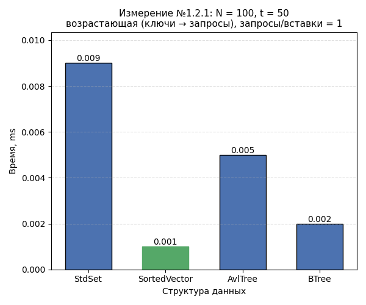

### Измерение №1.2.2

**Распределение:** возрастающая последовательность, сначала все ключи, затем запросы

**R:** 1

**Уникальных ключей:** 10000

**Дубликатов:** 3 500

**Датасет:** ```research/datasets/data_1_2_2.txt```

| Реализация   | Time, ms  | CPU, ms   | Отн. времени (лучший = 1.00) |
|--------------|-----------|-----------|------------------------------|
| StdSet       |      97.5 |      97.5 |                       343.31 |
| SortedVector | **0.284** | **0.284** |                     **1.00** |
| AVL-tree     |      1.39 |      1.39 |                         4.89 |
| B-tree       |     0.953 |     0.953 |                         3.36 |


### Измерение №1.2.3

**Распределение:** возрастающая последовательность, сначала все ключи, затем запросы

**R:** 1

**Уникальных ключей:** 1000000

**Дубликатов:** 350 000

**Датасет:** ```research/datasets/data_1_2_3.txt```

| Реализация   | Time, ms  | CPU, ms   | Отн. времени (лучший = 1.00) |
|--------------|-----------|-----------|------------------------------|
| StdSet       | 1.056e+06 | 1.056e+06 |                     13095.74 |
| SortedVector | **80.66** | **80.66** |                     **1.00** |
| AVL-tree     |     386.4 |     386.4 |                         4.79 |
| B-tree       |     454.1 |     454.1 |                         5.63 |


### Измерение №1.3.1

**Распределение:** возрастающая последовательность, сначала все ключи, затем запросы

**R:** 7/3

**Уникальных ключей:** 100

**Дубликатов:** 35

**Датасет:** ```research/datasets/data_1_3_1.txt```

| Реализация   | Time, ms  | CPU, ms   | Отн. времени (лучший = 1.00) |
|--------------|-----------|-----------|------------------------------|
| StdSet       |     0.019 |     0.019 |                         9.50 |
| SortedVector | **0.002** | **0.002** |                     **1.00** |
| AVL-tree     |     0.007 |     0.007 |                         3.50 |
| B-tree       |     0.004 |     0.004 |                         2.00 |

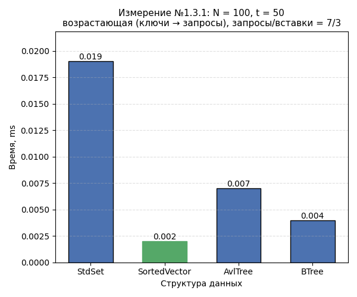

### Измерение №1.3.2

**Распределение:** возрастающая последовательность, сначала все ключи, затем запросы

**R:** 7/3

**Уникальных ключей:** 10000

**Дубликатов:** 3 500

**Датасет:** ```research/datasets/data_1_3_2.txt```

| Реализация   | Time, ms  | CPU, ms   | Отн. времени (лучший = 1.00) |
|--------------|-----------|-----------|------------------------------|
| StdSet       |       236 |       236 |                       343.02 |
| SortedVector | **0.688** | **0.688** |                     **1.00** |
| AVL-tree     |      2.69 |      2.69 |                         3.91 |
| B-tree       |      2.06 |      2.06 |                         2.99 |

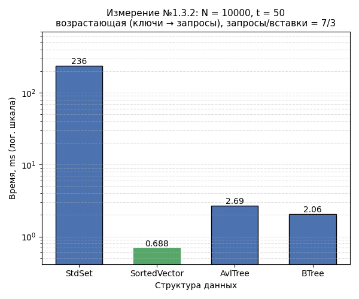

### Измерение №1.3.3

**Распределение:** возрастающая последовательность, сначала все ключи, затем запросы

**R:** 7/3

**Уникальных ключей:** 1000000

**Дубликатов:** 350 000

**Датасет:** ```research/datasets/data_1_3_3.txt```

| Реализация   | Time, ms  | CPU, ms   | Отн. времени (лучший = 1.00) |
|--------------|-----------|-----------|------------------------------|
| StdSet       | 2.931e+06 | 2.931e+06 |                     12385.78 |
| SortedVector | **236.7** | **236.7** |                     **1.00** |
| AVL-tree     |      1034 |      1034 |                         4.37 |
| B-tree       |      1061 |      1061 |                         4.48 |

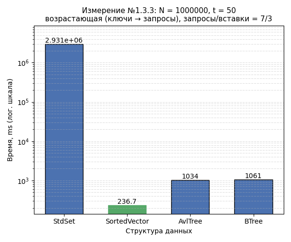

### Измерение №2.1.1

**Распределение:** возрастающая последовательность, ключи и запросы равномерно перемешаны

**R:** 3/7

**Уникальных ключей:** 100

**Дубликатов:** 35

**Датасет:** ```research/datasets/data_2_1_1.txt```

| Реализация   | Time, ms  | CPU, ms   | Отн. времени (лучший = 1.00) |
|--------------|-----------|-----------|------------------------------|
| StdSet       |     0.004 |     0.004 |                         4.00 |
| SortedVector | **0.001** | **0.001** |                     **1.00** |
| AVL-tree     |     0.005 |     0.005 |                         5.00 |
| B-tree       |     0.001 |     0.001 |                         1.00 |

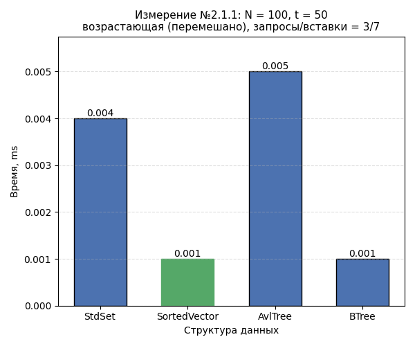

### Измерение №2.1.2

**Распределение:** возрастающая последовательность, ключи и запросы равномерно перемешаны

**R:** 3/7

**Уникальных ключей:** 10000

**Дубликатов:** 3 500

**Датасет:** ```research/datasets/data_2_1_2.txt```

| Реализация   | Time, ms  | CPU, ms   | Отн. времени (лучший = 1.00) |
|--------------|-----------|-----------|------------------------------|
| StdSet       |      23.7 |      23.7 |                       289.02 |
| SortedVector | **0.082** | **0.082** |                     **1.00** |
| AVL-tree     |     0.826 |     0.826 |                        10.07 |
| B-tree       |     0.499 |     0.499 |                         6.09 |

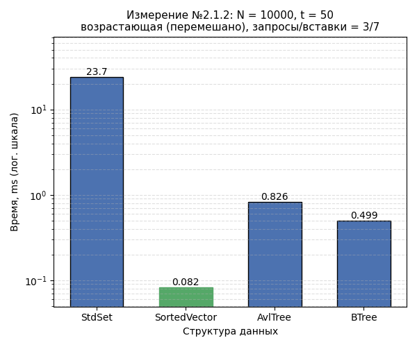

### Измерение №2.1.3

**Распределение:** возрастающая последовательность, ключи и запросы равномерно перемешаны

**R:** 3/7

**Уникальных ключей:** 1000000

**Дубликатов:** 350 000

**Датасет:** ```research/datasets/data_2_1_3.txt```

| Реализация   | Time, ms  | CPU, ms   | Отн. времени (лучший = 1.00) |
|--------------|-----------|-----------|------------------------------|
| StdSet       | 1.404e+05 | 1.404e+05 |                     20883.77 |
| SortedVector | **6.724** | **6.724** |                     **1.00** |
| AVL-tree     |     136.5 |     136.5 |                        20.29 |
| B-tree       |       249 |       249 |                        37.03 |

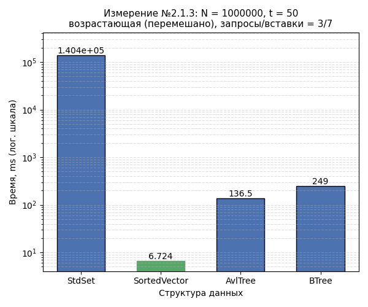

### Измерение №2.2.1

**Распределение:** возрастающая последовательность, ключи и запросы равномерно перемешаны

**R:** 1

**Уникальных ключей:** 100

**Дубликатов:** 35

**Датасет:** ```research/datasets/data_2_2_1.txt```

| Реализация   | Time, ms  | CPU, ms   | Отн. времени (лучший = 1.00) |
|--------------|-----------|-----------|------------------------------|
| StdSet       |     0.006 |     0.006 |                         6.00 |
| SortedVector | **0.001** | **0.001** |                     **1.00** |
| AVL-tree     |     0.005 |     0.005 |                         5.00 |
| B-tree       |     0.002 |     0.002 |                         2.00 |

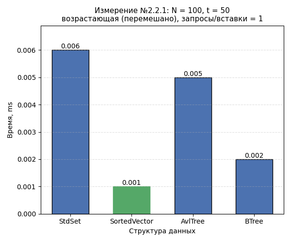

### Измерение №2.2.2

**Распределение:** возрастающая последовательность, ключи и запросы равномерно перемешаны

**R:** 1

**Уникальных ключей:** 10000

**Дубликатов:** 3 500

**Датасет:** ```research/datasets/data_2_2_2.txt```

| Реализация   | Time, ms  | CPU, ms   | Отн. времени (лучший = 1.00) |
|--------------|-----------|-----------|------------------------------|
| StdSet       |      51.6 |      51.6 |                       263.27 |
| SortedVector | **0.196** | **0.196** |                     **1.00** |
| AVL-tree     |      1.17 |      1.17 |                         5.97 |
| B-tree       |     0.853 |     0.853 |                         4.35 |

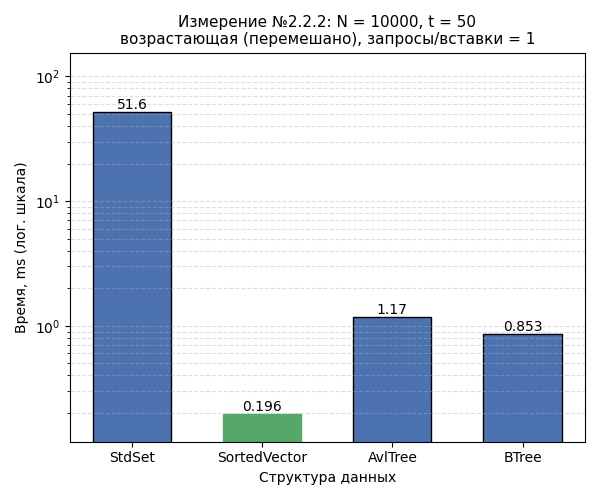

### Измерение №2.2.3

**Распределение:** возрастающая последовательность, ключи и запросы равномерно перемешаны

**R:** 1

**Уникальных ключей:** 1000000

**Дубликатов:** 350 000

**Датасет:** ```research/datasets/data_2_2_3.txt```

| Реализация   | Time, ms  | CPU, ms   | Отн. времени (лучший = 1.00) |
|--------------|-----------|-----------|------------------------------|
| StdSet       | 4.438e+05 | 4.438e+05 |                     11551.44 |
| SortedVector | **38.42** | **38.42** |                     **1.00** |
| AVL-tree     |     273.8 |     273.8 |                         7.13 |
| B-tree       |     363.8 |     363.8 |                         9.47 |


### Измерение №2.3.1

**Распределение:** возрастающая последовательность, ключи и запросы равномерно перемешаны

**R:** 7/3

**Уникальных ключей:** 100

**Дубликатов:** 35

**Датасет:** ```research/datasets/data_2_3_1.txt```

| Реализация   | Time, ms  | CPU, ms   | Отн. времени (лучший = 1.00) |
|--------------|-----------|-----------|------------------------------|
| StdSet       |     0.011 |     0.011 |                         5.50 |
| SortedVector | **0.002** | **0.002** |                     **1.00** |
| AVL-tree     |     0.007 |     0.007 |                         3.50 |
| B-tree       |     0.003 |     0.003 |                         1.50 |

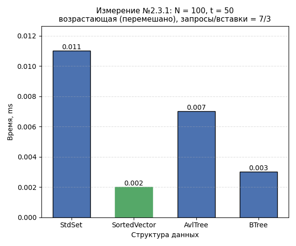

### Измерение №2.3.2

**Распределение:** возрастающая последовательность, ключи и запросы равномерно перемешаны

**R:** 7/3

**Уникальных ключей:** 10000

**Дубликатов:** 3 500

**Датасет:** ```research/datasets/data_2_3_2.txt```

| Реализация   | Time, ms  | CPU, ms   | Отн. времени (лучший = 1.00) |
|--------------|-----------|-----------|------------------------------|
| StdSet       |       130 |       130 |                       246.21 |
| SortedVector | **0.528** | **0.528** |                     **1.00** |
| AVL-tree     |      2.09 |      2.09 |                         3.96 |
| B-tree       |      1.77 |      1.77 |                         3.35 |


### Измерение №2.3.3

**Распределение:** возрастающая последовательность, ключи и запросы равномерно перемешаны

**R:** 7/3

**Уникальных ключей:** 1000000

**Дубликатов:** 350 000

**Датасет:** ```research/datasets/data_2_3_3.txt```

| Реализация   | Time, ms  | CPU, ms   | Отн. времени (лучший = 1.00) |
|--------------|-----------|-----------|------------------------------|
| StdSet       | 1.536e+06 | 1.536e+06 |                     11021.89 |
| SortedVector | **139.4** | **139.4** |                     **1.00** |
| AVL-tree     |       624 |       624 |                         4.48 |
| B-tree       |      1044 |      1044 |                         7.49 |

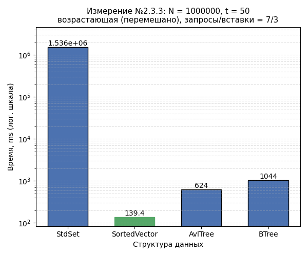

### Измерение №3.1.1

**Распределение:** убывающая последовательность, сначала все ключи, затем запросы

**R:** 3/7

**Уникальных ключей:** 100

**Дубликатов:** 35

**Датасет:** ```research/datasets/data_3_1_1.txt```

| Реализация   | Time, ms  | CPU, ms   | Отн. времени (лучший = 1.00) |
|--------------|-----------|-----------|------------------------------|
| StdSet       |     0.005 |     0.005 |                         5.00 |
| SortedVector | **0.001** | **0.001** |                     **1.00** |
| AVL-tree     |     0.004 |     0.004 |                         4.00 |
| B-tree       |     0.003 |     0.003 |                         3.00 |

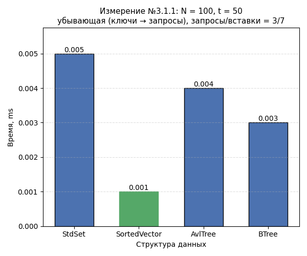

### Измерение №3.1.2

**Распределение:** убывающая последовательность, сначала все ключи, затем запросы

**R:** 3/7

**Уникальных ключей:** 10000

**Дубликатов:** 3 500

**Датасет:** ```research/datasets/data_3_1_2.txt```

| Реализация   | Time, ms  | CPU, ms   | Отн. времени (лучший = 1.00) |
|--------------|-----------|-----------|------------------------------|
| StdSet       |      48.2 |      48.2 |                       280.23 |
| SortedVector | **0.172** | **0.172** |                     **1.00** |
| AVL-tree     |     0.903 |     0.903 |                         5.25 |
| B-tree       |     0.713 |     0.713 |                         4.15 |

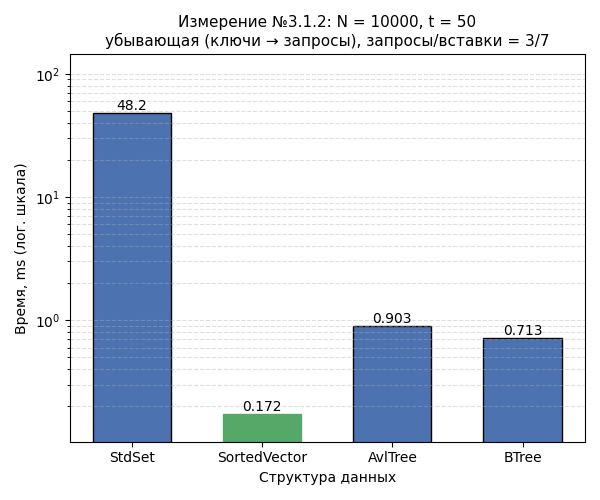

### Измерение №3.1.3

**Распределение:** убывающая последовательность, сначала все ключи, затем запросы

**R:** 3/7

**Уникальных ключей:** 1000000

**Дубликатов:** 350 000

**Датасет:** ```research/datasets/data_3_1_3.txt```

| Реализация   | Time, ms  | CPU, ms   | Отн. времени (лучший = 1.00) |
|--------------|-----------|-----------|------------------------------|
| StdSet       | 4.646e+05 | 4.646e+05 |                     15706.06 |
| SortedVector | **29.58** | **29.58** |                     **1.00** |
| AVL-tree     |     203.9 |     203.9 |                         6.89 |
| B-tree       |     169.5 |     169.5 |                         5.73 |

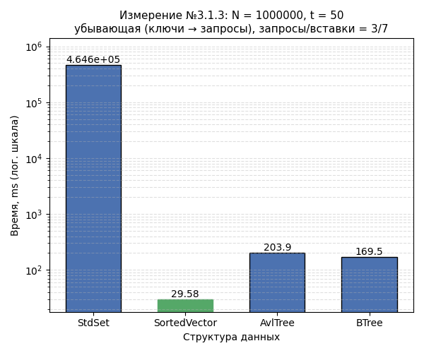

### Измерение №3.2.1

**Распределение:** убывающая последовательность, сначала все ключи, затем запросы

**R:** 1

**Уникальных ключей:** 100

**Дубликатов:** 35

**Датасет:** ```research/datasets/data_3_2_1.txt```

| Реализация   | Time, ms  | CPU, ms   | Отн. времени (лучший = 1.00) |
|--------------|-----------|-----------|------------------------------|
| StdSet       |     0.009 |     0.009 |                         9.00 |
| SortedVector | **0.001** | **0.001** |                     **1.00** |
| AVL-tree     |     0.005 |     0.005 |                         5.00 |
| B-tree       |     0.004 |     0.004 |                         4.00 |

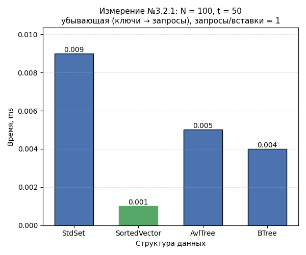

### Измерение №3.2.2

**Распределение:** убывающая последовательность, сначала все ключи, затем запросы

**R:** 1

**Уникальных ключей:** 10000

**Дубликатов:** 3 500

**Датасет:** ```research/datasets/data_3_2_2.txt```

| Реализация   | Time, ms  | CPU, ms   | Отн. времени (лучший = 1.00) |
|--------------|-----------|-----------|------------------------------|
| StdSet       |       111 |       111 |                       328.40 |
| SortedVector | **0.338** | **0.338** |                     **1.00** |
| AVL-tree     |      1.42 |      1.42 |                         4.20 |
| B-tree       |      1.13 |      1.13 |                         3.34 |


### Измерение №3.2.3

**Распределение:** убывающая последовательность, сначала все ключи, затем запросы

**R:** 1

**Уникальных ключей:** 1000000

**Дубликатов:** 350 000

**Датасет:** ```research/datasets/data_3_2_3.txt```

| Реализация   | Time, ms  | CPU, ms   | Отн. времени (лучший = 1.00) |
|--------------|-----------|-----------|------------------------------|
| StdSet       | 1.369e+06 | 1.369e+06 |                     11983.12 |
| SortedVector | **114.2** | **114.2** |                     **1.00** |
| AVL-tree     |     403.3 |     403.3 |                         3.53 |
| B-tree       |     319.2 |     319.2 |                         2.79 |

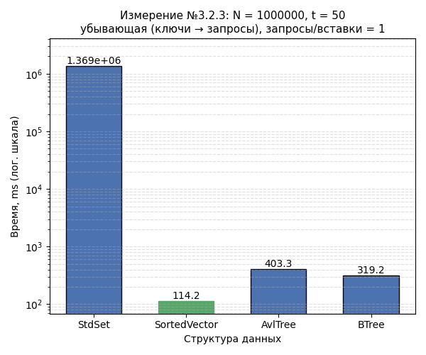

### Измерение №3.3.1

**Распределение:** убывающая последовательность, сначала все ключи, затем запросы

**R:** 7/3

**Уникальных ключей:** 100

**Дубликатов:** 35

**Датасет:** ```research/datasets/data_3_3_1.txt```

| Реализация   | Time, ms  | CPU, ms   | Отн. времени (лучший = 1.00) |
|--------------|-----------|-----------|------------------------------|
| StdSet       |     0.019 |     0.019 |                         9.50 |
| SortedVector | **0.002** | **0.002** |                     **1.00** |
| AVL-tree     |     0.007 |     0.007 |                         3.50 |
| B-tree       |     0.005 |     0.005 |                         2.50 |

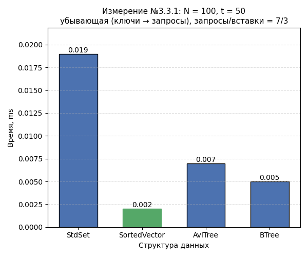

### Измерение №3.3.2

**Распределение:** убывающая последовательность, сначала все ключи, затем запросы

**R:** 7/3

**Уникальных ключей:** 10000

**Дубликатов:** 3 500

**Датасет:** ```research/datasets/data_3_3_2.txt```

| Реализация   | Time, ms  | CPU, ms   | Отн. времени (лучший = 1.00) |
|--------------|-----------|-----------|------------------------------|
| StdSet       |       244 |       244 |                       324.90 |
| SortedVector | **0.751** | **0.751** |                     **1.00** |
| AVL-tree     |      2.63 |      2.63 |                         3.50 |
| B-tree       |      2.19 |      2.19 |                         2.92 |


### Измерение №3.3.3

**Распределение:** убывающая последовательность, сначала все ключи, затем запросы

**R:** 7/3

**Уникальных ключей:** 1000000

**Дубликатов:** 350 000

**Датасет:** ```research/datasets/data_3_3_3.txt```

| Реализация   | Time, ms  | CPU, ms   | Отн. времени (лучший = 1.00) |
|--------------|-----------|-----------|------------------------------|
| StdSet       | 3.133e+06 | 3.133e+06 |                     11111.59 |
| SortedVector |   **282** |   **282** |                     **1.00** |
| AVL-tree     |     988.1 |     988.1 |                         3.50 |
| B-tree       |     959.2 |     959.2 |                         3.40 |

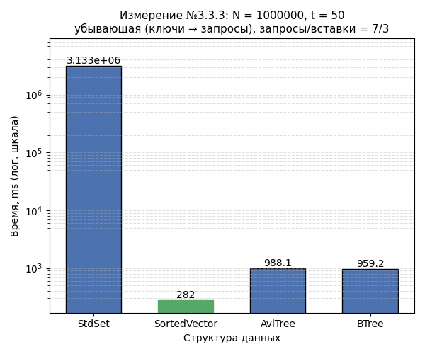

### Измерение №4.1.1

**Распределение:** убывающая последовательность, ключи и запросы равномерно перемешаны

**R:** 3/7

**Уникальных ключей:** 100

**Дубликатов:** 35

**Датасет:** ```research/datasets/data_4_1_1.txt```

| Реализация   | Time, ms  | CPU, ms   | Отн. времени (лучший = 1.00) |
|--------------|-----------|-----------|------------------------------|
| StdSet       |     0.004 |     0.004 |                         1.33 |
| SortedVector |     0.005 |     0.005 |                         1.67 |
| AVL-tree     |     0.004 |     0.004 |                         1.33 |
| B-tree       | **0.003** | **0.003** |                     **1.00** |

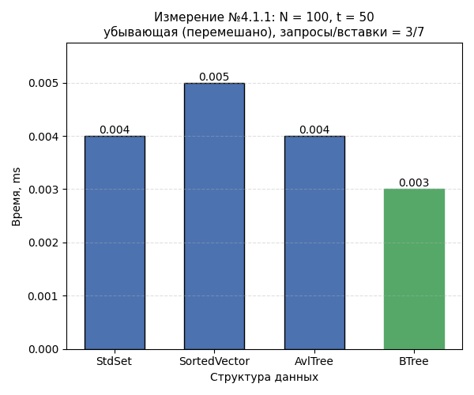

### Измерение №4.1.2

**Распределение:** убывающая последовательность, ключи и запросы равномерно перемешаны

**R:** 3/7

**Уникальных ключей:** 10000

**Дубликатов:** 3 500

**Датасет:** ```research/datasets/data_4_1_2.txt```

| Реализация   | Time, ms  | CPU, ms   | Отн. времени (лучший = 1.00) |
|--------------|-----------|-----------|------------------------------|
| StdSet       |      17.9 |      17.9 |                        26.64 |
| SortedVector |      19.4 |      19.4 |                        28.87 |
| AVL-tree     |     0.809 |     0.809 |                         1.20 |
| B-tree       | **0.672** | **0.672** |                     **1.00** |

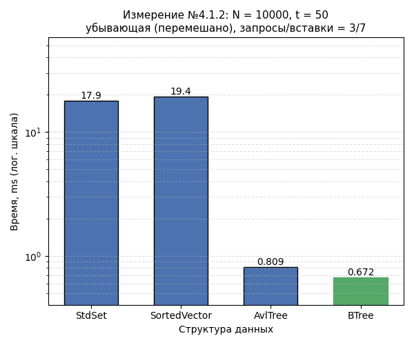

### Измерение №4.1.3

**Распределение:** убывающая последовательность, ключи и запросы равномерно перемешаны

**R:** 3/7

**Уникальных ключей:** 1000000

**Дубликатов:** 350 000

**Датасет:** ```research/datasets/data_4_1_3.txt```

| Реализация   | Time, ms  | CPU, ms   | Отн. времени (лучший = 1.00) |
|--------------|-----------|-----------|------------------------------|
| StdSet       |  8.01e+04 |  8.01e+04 |                       532.14 |
| SortedVector | 7.527e+04 | 7.527e+04 |                       500.05 |
| AVL-tree     |     163.6 |     163.6 |                         1.09 |
| B-tree       | **150.5** | **150.5** |                     **1.00** |

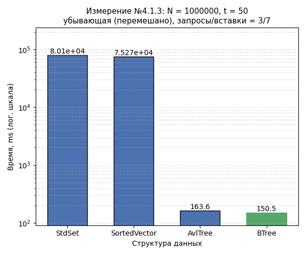

### Измерение №4.2.1

**Распределение:** убывающая последовательность, ключи и запросы равномерно перемешаны

**R:** 1

**Уникальных ключей:** 100

**Дубликатов:** 35

**Датасет:** ```research/datasets/data_4_2_1.txt```

| Реализация   | Time, ms  | CPU, ms   | Отн. времени (лучший = 1.00) |
|--------------|-----------|-----------|------------------------------|
| StdSet       |     0.006 |     0.006 |                         2.00 |
| SortedVector |     0.008 |     0.008 |                         2.67 |
| AVL-tree     |     0.005 |     0.005 |                         1.67 |
| B-tree       | **0.003** | **0.003** |                     **1.00** |

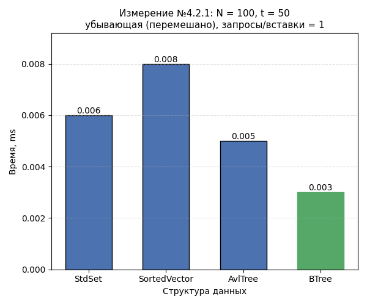

### Измерение №4.2.2

**Распределение:** убывающая последовательность, ключи и запросы равномерно перемешаны

**R:** 1

**Уникальных ключей:** 10000

**Дубликатов:** 3 500

**Датасет:** ```research/datasets/data_4_2_2.txt```

| Реализация   | Time, ms | CPU, ms  | Отн. времени (лучший = 1.00) |
|--------------|----------|----------|------------------------------|
| StdSet       |     42.2 |     42.2 |                        41.78 |
| SortedVector |     33.3 |     33.3 |                        32.97 |
| AVL-tree     |     1.19 |     1.19 |                         1.18 |
| B-tree       | **1.01** | **1.01** |                     **1.00** |

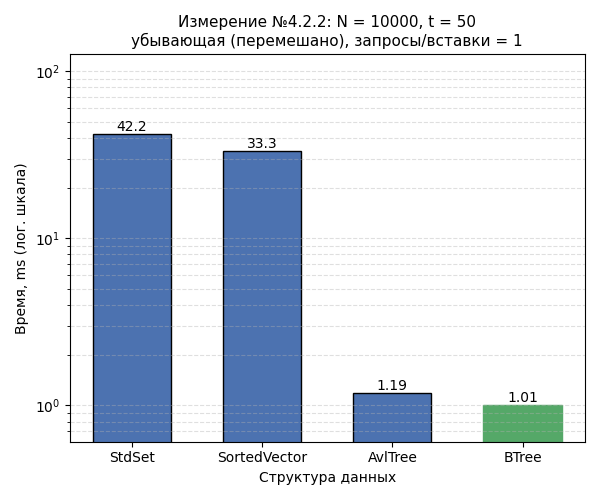

### Измерение №4.2.3

**Распределение:** убывающая последовательность, ключи и запросы равномерно перемешаны

**R:** 1

**Уникальных ключей:** 1000000

**Дубликатов:** 350 000

**Датасет:** ```research/datasets/data_4_2_3.txt```

| Реализация   | Time, ms  | CPU, ms   | Отн. времени (лучший = 1.00) |
|--------------|-----------|-----------|------------------------------|
| StdSet       | 2.968e+05 | 2.968e+05 |                      1047.97 |
| SortedVector | 1.386e+05 | 1.386e+05 |                       489.41 |
| AVL-tree     | **283.2** | **283.2** |                     **1.00** |
| B-tree       |       340 |       340 |                         1.20 |

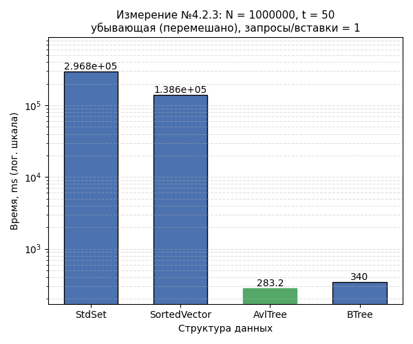

### Измерение №4.3.1

**Распределение:** убывающая последовательность, ключи и запросы равномерно перемешаны

**R:** 7/3

**Уникальных ключей:** 100

**Дубликатов:** 35

**Датасет:** ```research/datasets/data_4_3_1.txt```

| Реализация   | Time, ms  | CPU, ms   | Отн. времени (лучший = 1.00) |
|--------------|-----------|-----------|------------------------------|
| StdSet       |      0.01 |      0.01 |                         2.50 |
| SortedVector |     0.012 |     0.012 |                         3.00 |
| AVL-tree     |     0.006 |     0.006 |                         1.50 |
| B-tree       | **0.004** | **0.004** |                     **1.00** |

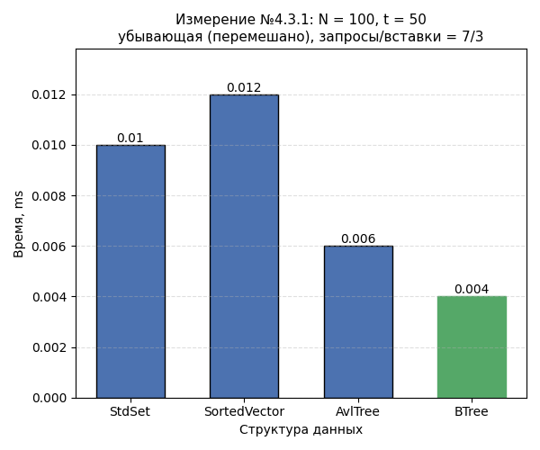

### Измерение №4.3.2

**Распределение:** убывающая последовательность, ключи и запросы равномерно перемешаны

**R:** 7/3

**Уникальных ключей:** 10000

**Дубликатов:** 3 500

**Датасет:** ```research/datasets/data_4_3_2.txt```

| Реализация   | Time, ms | CPU, ms  | Отн. времени (лучший = 1.00) |
|--------------|----------|----------|------------------------------|
| StdSet       |     95.2 |     95.2 |                        50.64 |
| SortedVector |     44.8 |     44.8 |                        23.83 |
| AVL-tree     |     2.01 |     2.01 |                         1.07 |
| B-tree       | **1.88** | **1.88** |                     **1.00** |

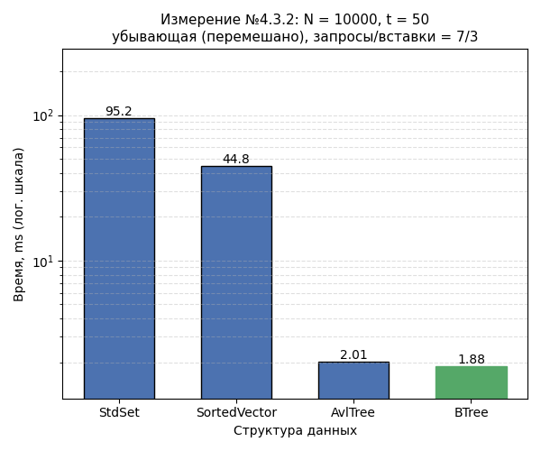

### Измерение №4.3.3

**Распределение:** убывающая последовательность, ключи и запросы равномерно перемешаны

**R:** 7/3

**Уникальных ключей:** 1000000

**Дубликатов:** 350 000

**Датасет:** ```research/datasets/data_4_3_3.txt```

| Реализация   | Time, ms  | CPU, ms   | Отн. времени (лучший = 1.00) |
|--------------|-----------|-----------|------------------------------|
| StdSet       | 9.063e+05 | 9.063e+05 |                      1345.96 |
| SortedVector | 1.673e+05 | 1.673e+05 |                       248.39 |
| AVL-tree     | **673.3** | **673.3** |                     **1.00** |
| B-tree       |     883.6 |     883.6 |                         1.31 |

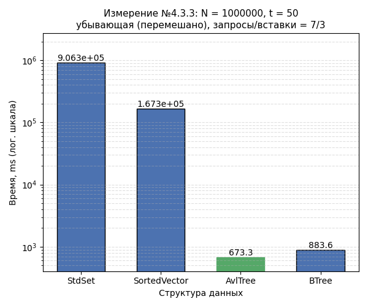

### Измерение №5.1.1

**Распределение:** случайное распределение, сначала все ключи, затем запросы

**R:** 3/7

**Уникальных ключей:** 100

**Дубликатов:** 35

**Датасет:** ```research/datasets/data_5_1_1.txt```

| Реализация   | Time, ms  | CPU, ms   | Отн. времени (лучший = 1.00) |
|--------------|-----------|-----------|------------------------------|
| StdSet       |     0.005 |     0.005 |                         5.00 |
| SortedVector | **0.001** | **0.001** |                     **1.00** |
| AVL-tree     |     0.005 |     0.005 |                         5.00 |
| B-tree       |     0.003 |     0.003 |                         3.00 |

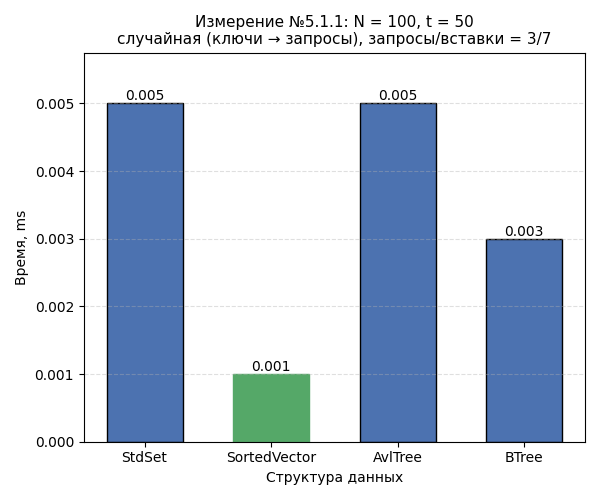

### Измерение №5.1.2

**Распределение:** случайное распределение, сначала все ключи, затем запросы

**R:** 3/7

**Уникальных ключей:** 10000

**Дубликатов:** 3 500

**Датасет:** ```research/datasets/data_5_1_2.txt```

| Реализация   | Time, ms  | CPU, ms   | Отн. времени (лучший = 1.00) |
|--------------|-----------|-----------|------------------------------|
| StdSet       |      92.1 |      92.1 |                       487.30 |
| SortedVector | **0.189** | **0.189** |                     **1.00** |
| AVL-tree     |      1.29 |      1.29 |                         6.83 |
| B-tree       |     0.803 |     0.803 |                         4.25 |

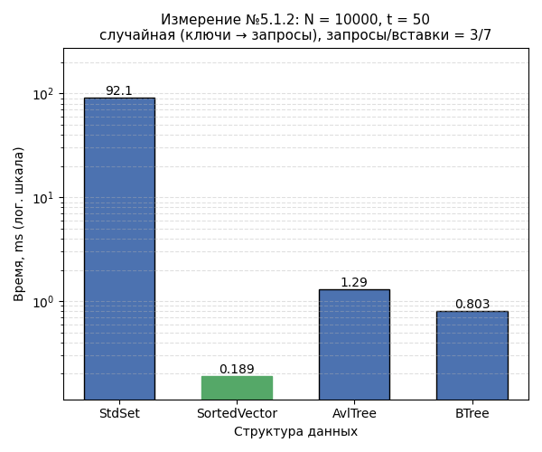

### Измерение №5.1.3

**Распределение:** случайное распределение, сначала все ключи, затем запросы

**R:** 3/7

**Уникальных ключей:** 1000000

**Дубликатов:** 350 000

**Датасет:** ```research/datasets/data_5_1_3.txt```

| Реализация   | Time, ms  | CPU, ms   | Отн. времени (лучший = 1.00) |
|--------------|-----------|-----------|------------------------------|
| StdSet       | 1.696e+06 | 1.696e+06 |                     47492.57 |
| SortedVector | **35.72** | **35.72** |                     **1.00** |
| AVL-tree     |     332.8 |     332.8 |                         9.32 |
| B-tree       |     214.9 |     214.9 |                         6.02 |

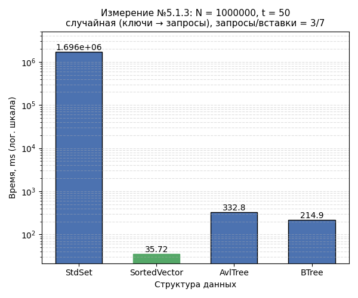

### Измерение №5.2.1

**Распределение:** случайное распределение, сначала все ключи, затем запросы

**R:** 1

**Уникальных ключей:** 100

**Дубликатов:** 35

**Датасет:** ```research/datasets/data_5_2_1.txt```

| Реализация   | Time, ms  | CPU, ms   | Отн. времени (лучший = 1.00) |
|--------------|-----------|-----------|------------------------------|
| StdSet       |      0.01 |      0.01 |                         5.00 |
| SortedVector | **0.002** | **0.002** |                     **1.00** |
| AVL-tree     |     0.005 |     0.005 |                         2.50 |
| B-tree       |     0.003 |     0.003 |                         1.50 |

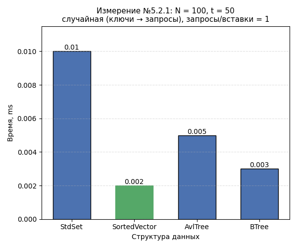

### Измерение №5.2.2

**Распределение:** случайное распределение, сначала все ключи, затем запросы

**R:** 1

**Уникальных ключей:** 10000

**Дубликатов:** 3 500

**Датасет:** ```research/datasets/data_5_2_2.txt```

| Реализация   | Time, ms  | CPU, ms   | Отн. времени (лучший = 1.00) |
|--------------|-----------|-----------|------------------------------|
| StdSet       |       248 |       248 |                       698.59 |
| SortedVector | **0.355** | **0.355** |                     **1.00** |
| AVL-tree     |      1.81 |      1.81 |                         5.10 |
| B-tree       |      1.22 |      1.22 |                         3.44 |

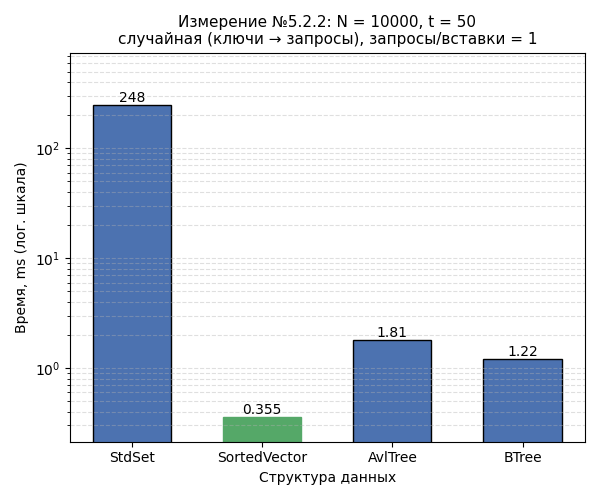

### Измерение №5.2.3

**Распределение:** случайное распределение, сначала все ключи, затем запросы

**R:** 1

**Уникальных ключей:** 1000000

**Дубликатов:** 350 000

**Датасет:** ```research/datasets/data_5_2_3.txt```

| Реализация   | Time, ms  | CPU, ms   | Отн. времени (лучший = 1.00) |
|--------------|-----------|-----------|------------------------------|
| StdSet       |  6.15e+06 |  6.15e+06 |                     97606.03 |
| SortedVector | **63.01** | **63.01** |                     **1.00** |
| AVL-tree     |     655.2 |     655.2 |                        10.40 |
| B-tree       |     496.1 |     496.1 |                         7.87 |

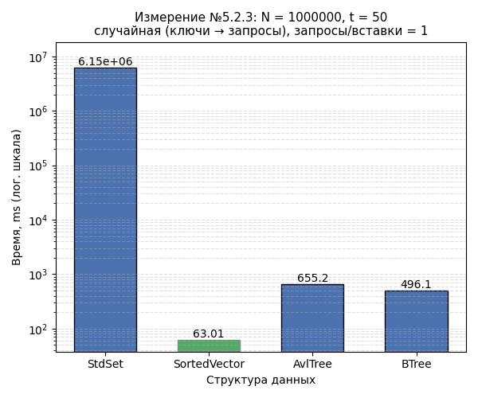

### Измерение №5.3.1

**Распределение:** случайное распределение, сначала все ключи, затем запросы

**R:** 7/3

**Уникальных ключей:** 100

**Дубликатов:** 35

**Датасет:** ```research/datasets/data_5_3_1.txt```

| Реализация   | Time, ms  | CPU, ms   | Отн. времени (лучший = 1.00) |
|--------------|-----------|-----------|------------------------------|
| StdSet       |      0.02 |      0.02 |                         6.67 |
| SortedVector | **0.003** | **0.003** |                     **1.00** |
| AVL-tree     |     0.007 |     0.007 |                         2.33 |
| B-tree       |     0.005 |     0.005 |                         1.67 |

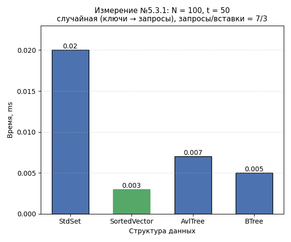

### Измерение №5.3.2

**Распределение:** случайное распределение, сначала все ключи, затем запросы

**R:** 7/3

**Уникальных ключей:** 10000

**Дубликатов:** 3 500

**Датасет:** ```research/datasets/data_5_3_2.txt```

| Реализация   | Time, ms  | CPU, ms   | Отн. времени (лучший = 1.00) |
|--------------|-----------|-----------|------------------------------|
| StdSet       |       576 |       576 |                       753.93 |
| SortedVector | **0.764** | **0.764** |                     **1.00** |
| AVL-tree     |      3.16 |      3.16 |                         4.14 |
| B-tree       |      2.26 |      2.26 |                         2.96 |

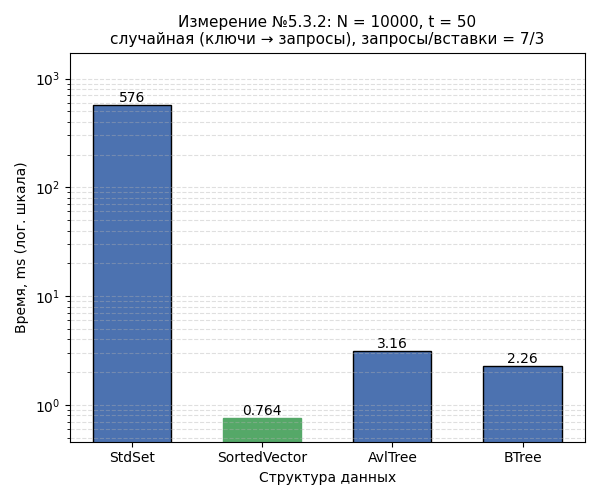

### Измерение №5.3.3

**Распределение:** случайное распределение, сначала все ключи, затем запросы

**R:** 7/3

**Уникальных ключей:** 1000000

**Дубликатов:** 350 000

**Датасет:** ```research/datasets/data_5_3_3.txt```

| Реализация   | Time, ms  | CPU, ms   | Отн. времени (лучший = 1.00) |
|--------------|-----------|-----------|------------------------------|
| StdSet       | 1.659e+07 | 1.659e+07 |                     85260.82 |
| SortedVector | **194.6** | **194.6** |                     **1.00** |
| AVL-tree     |      1427 |      1427 |                         7.33 |
| B-tree       |      1022 |      1022 |                         5.25 |

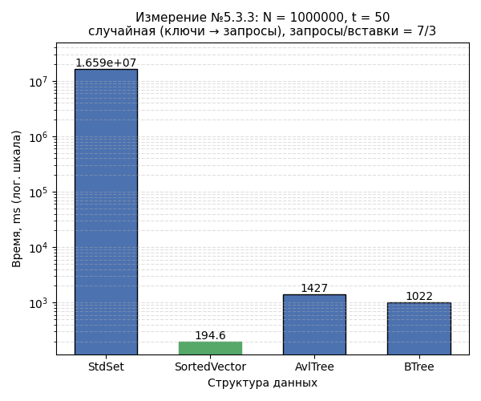

### Измерение №6.1.1

**Распределение:** случайное распределение, ключи и запросы равномерно перемешаны

**R:** 3/7

**Уникальных ключей:** 100

**Дубликатов:** 35

**Датасет:** ```research/datasets/data_6_1_1.txt```

| Реализация   | Time, ms  | CPU, ms   | Отн. времени (лучший = 1.00) |
|--------------|-----------|-----------|------------------------------|
| StdSet       |     0.005 |     0.005 |                         2.50 |
| SortedVector |     0.004 |     0.004 |                         2.00 |
| AVL-tree     |     0.004 |     0.004 |                         2.00 |
| B-tree       | **0.002** | **0.002** |                     **1.00** |

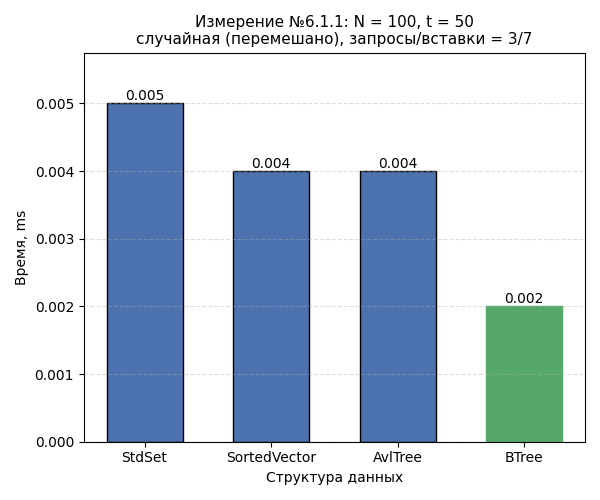

### Измерение №6.1.2

**Распределение:** случайное распределение, ключи и запросы равномерно перемешаны

**R:** 3/7

**Уникальных ключей:** 10000

**Дубликатов:** 3 500

**Датасет:** ```research/datasets/data_6_1_2.txt```

| Реализация   | Time, ms  | CPU, ms   | Отн. времени (лучший = 1.00) |
|--------------|-----------|-----------|------------------------------|
| StdSet       |      37.4 |      37.4 |                        52.31 |
| SortedVector |      22.4 |      22.4 |                        31.33 |
| AVL-tree     |      1.31 |      1.31 |                         1.83 |
| B-tree       | **0.715** | **0.715** |                     **1.00** |

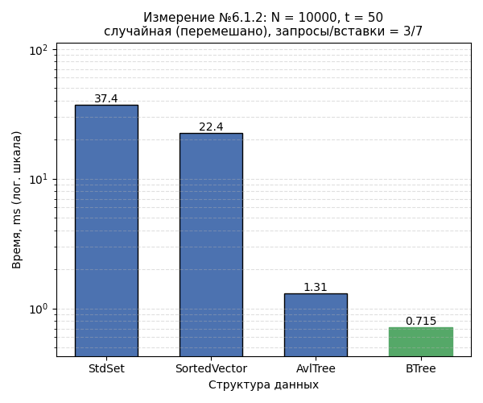

### Измерение №6.1.3

**Распределение:** случайное распределение, ключи и запросы равномерно перемешаны

**R:** 3/7

**Уникальных ключей:** 1000000

**Дубликатов:** 350 000

**Датасет:** ```research/datasets/data_6_1_3.txt```

| Реализация   | Time, ms  | CPU, ms   | Отн. времени (лучший = 1.00) |
|--------------|-----------|-----------|------------------------------|
| StdSet       | 2.798e+05 | 2.798e+05 |                      1094.44 |
| SortedVector | 1.254e+05 | 1.254e+05 |                       490.74 |
| AVL-tree     |       429 |       429 |                         1.68 |
| B-tree       | **255.6** | **255.6** |                     **1.00** |

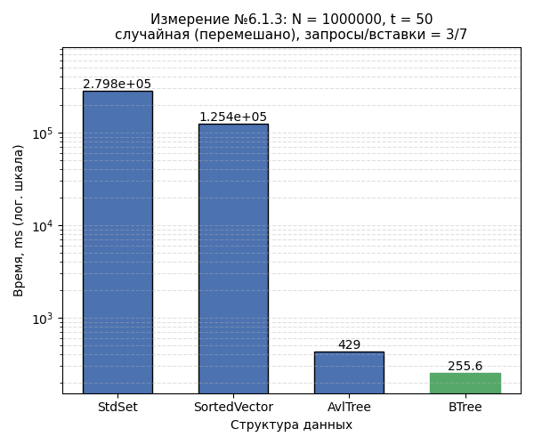

### Измерение №6.2.1

**Распределение:** случайное распределение, ключи и запросы равномерно перемешаны

**R:** 1

**Уникальных ключей:** 100

**Дубликатов:** 35

**Датасет:** ```research/datasets/data_6_2_1.txt```

| Реализация   | Time, ms  | CPU, ms   | Отн. времени (лучший = 1.00) |
|--------------|-----------|-----------|------------------------------|
| StdSet       |     0.006 |     0.006 |                         2.00 |
| SortedVector |     0.006 |     0.006 |                         2.00 |
| AVL-tree     |     0.005 |     0.005 |                         1.67 |
| B-tree       | **0.003** | **0.003** |                     **1.00** |

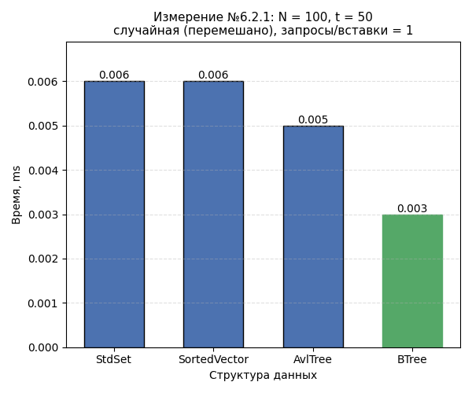

### Измерение №6.2.2

**Распределение:** случайное распределение, ключи и запросы равномерно перемешаны

**R:** 1

**Уникальных ключей:** 10000

**Дубликатов:** 3 500

**Датасет:** ```research/datasets/data_6_2_2.txt```

| Реализация   | Time, ms | CPU, ms  | Отн. времени (лучший = 1.00) |
|--------------|----------|----------|------------------------------|
| StdSet       |       81 |       81 |                        71.68 |
| SortedVector |     31.3 |     31.3 |                        27.70 |
| AVL-tree     |     1.84 |     1.84 |                         1.63 |
| B-tree       | **1.13** | **1.13** |                     **1.00** |

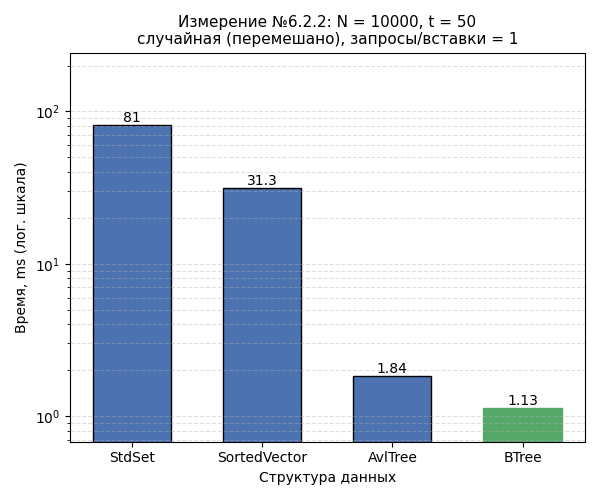

### Измерение №6.2.3

**Распределение:** случайное распределение, ключи и запросы равномерно перемешаны

**R:** 1

**Уникальных ключей:** 1000000

**Дубликатов:** 350 000

**Датасет:** ```research/datasets/data_6_2_3.txt```

| Реализация   | Time, ms  | CPU, ms   | Отн. времени (лучший = 1.00) |
|--------------|-----------|-----------|------------------------------|
| StdSet       | 1.094e+06 | 1.094e+06 |                      2569.11 |
| SortedVector | 1.633e+05 | 1.633e+05 |                       383.62 |
| AVL-tree     |     677.1 |     677.1 |                         1.59 |
| B-tree       | **425.6** | **425.6** |                     **1.00** |

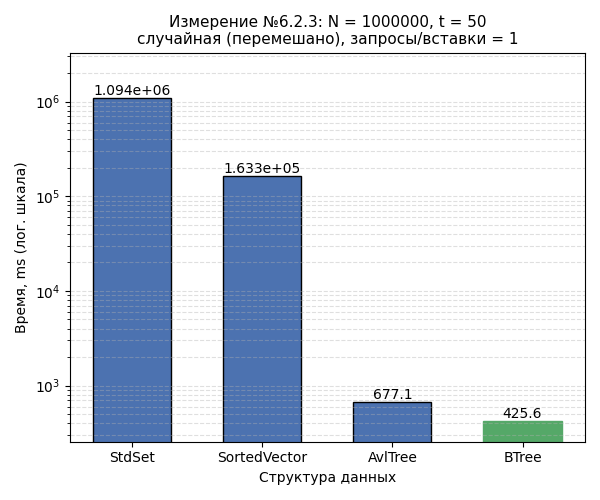

### Измерение №6.3.1

**Распределение:** случайное распределение, ключи и запросы равномерно перемешаны

**R:** 7/3

**Уникальных ключей:** 100

**Дубликатов:** 35

**Датасет:** ```research/datasets/data_6_3_1.txt```

| Реализация   | Time, ms  | CPU, ms   | Отн. времени (лучший = 1.00) |
|--------------|-----------|-----------|------------------------------|
| StdSet       |     0.011 |     0.011 |                         2.75 |
| SortedVector |     0.008 |     0.008 |                         2.00 |
| AVL-tree     |     0.007 |     0.007 |                         1.75 |
| B-tree       | **0.004** | **0.004** |                     **1.00** |

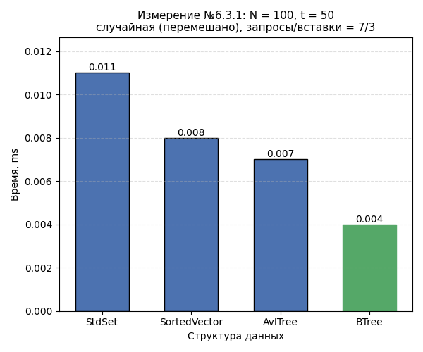

### Измерение №6.3.2

**Распределение:** случайное распределение, ключи и запросы равномерно перемешаны

**R:** 7/3

**Уникальных ключей:** 10000

**Дубликатов:** 3 500

**Датасет:** ```research/datasets/data_6_3_2.txt```

| Реализация   | Time, ms | CPU, ms  | Отн. времени (лучший = 1.00) |
|--------------|----------|----------|------------------------------|
| StdSet       |      190 |      190 |                        92.23 |
| SortedVector |     39.3 |     39.3 |                        19.08 |
| AVL-tree     |     3.09 |     3.09 |                         1.50 |
| B-tree       | **2.06** | **2.06** |                     **1.00** |

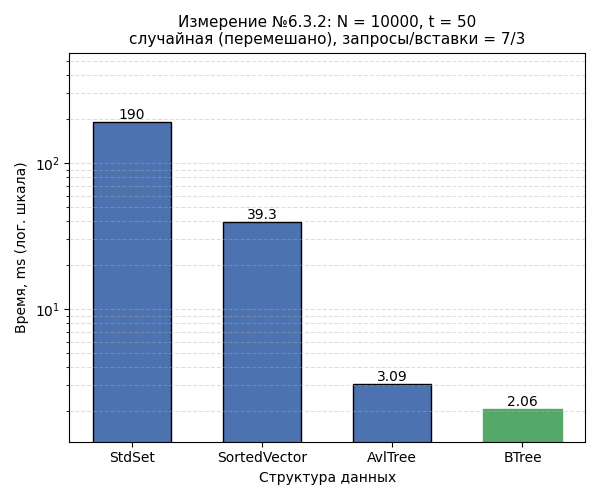

### Измерение №6.3.3

**Распределение:** случайное распределение, ключи и запросы равномерно перемешаны

**R:** 7/3

**Уникальных ключей:** 1000000

**Дубликатов:** 350 000

**Датасет:** ```research/datasets/data_6_3_3.txt```

| Реализация   | Time, ms  | CPU, ms   | Отн. времени (лучший = 1.00) |
|--------------|-----------|-----------|------------------------------|
| StdSet       | 3.282e+06 | 3.282e+06 |                      3093.43 |
| SortedVector | 1.931e+05 | 1.931e+05 |                       181.98 |
| AVL-tree     |      1364 |      1364 |                         1.29 |
| B-tree       |  **1061** |  **1061** |                     **1.00** |

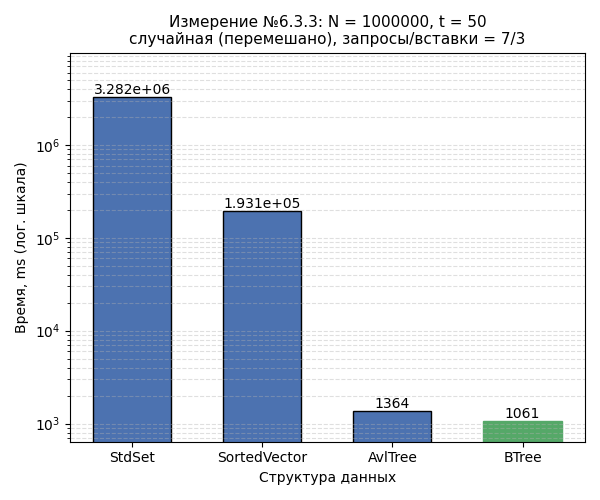
