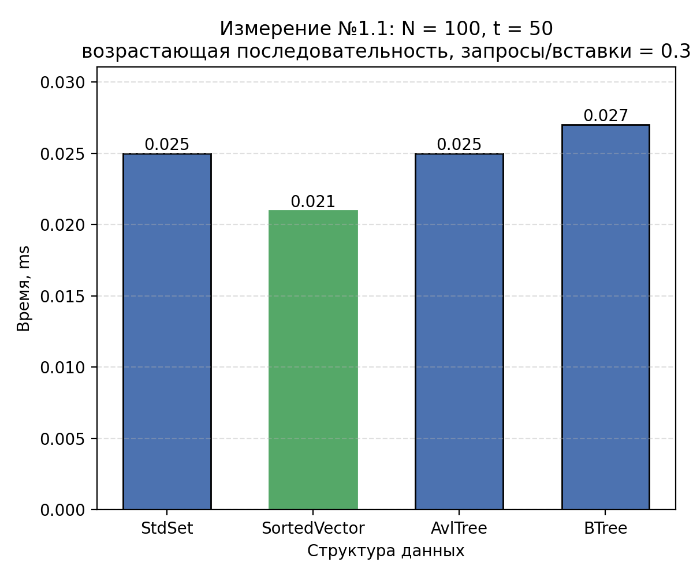
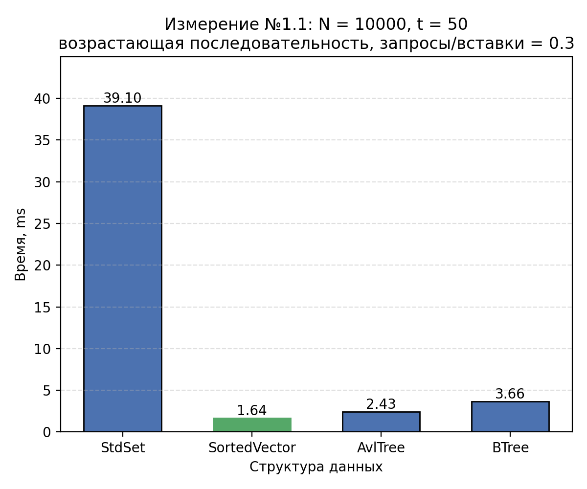
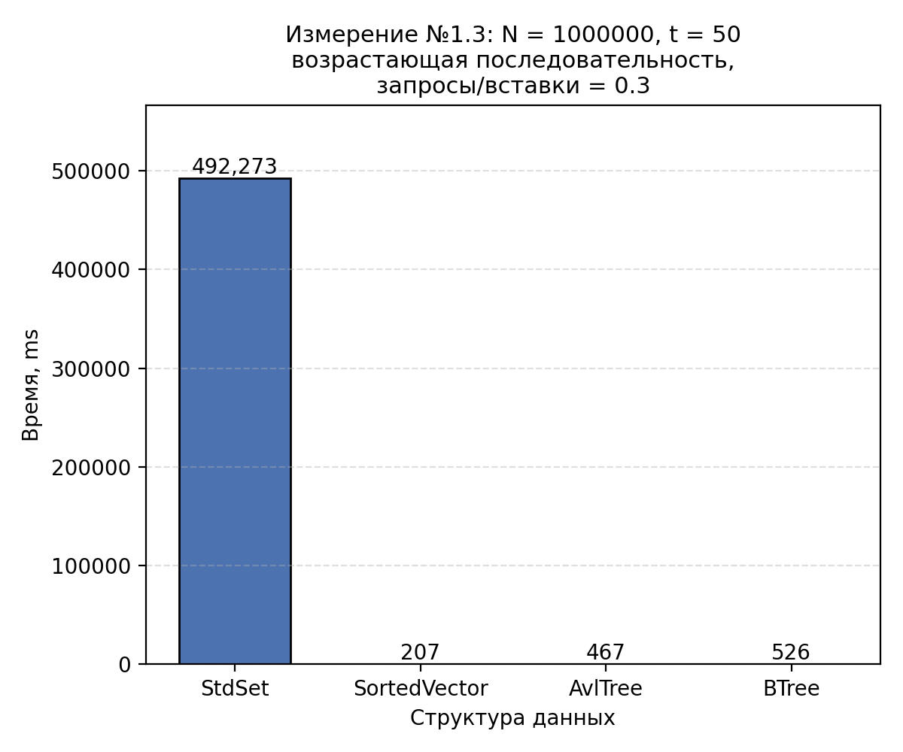

# Исследование реализаций динамического множества целых ключей с запросами.

## Цель работы.

Исследовать модель запросов на множестве целых ключей, реализованную на различных
структурах данных:
- std::set
- упорядоченный std::vector
- дополненное AVL - дерево
- B - дерево

## Методика измерений

Для выявления преимуществ одной структуры данных над другой в ходе исследования изменялись следующие параметры:

* Размер множеств
* Отношение $\frac{\text{число запросов}}{\text{число вставок}}$
* функция распределения ключей

На каждый эксперимент проводится измерение времени, в течении которого получается
результат обработки последовательности запросов.

Для измерения зависимости скорости обработки от соотношения $\frac{\text{число запросов}}{\text{число вставок}}$ проводится
3 эксперимента:

**(1.3)** $\frac{\text{число запросов}}{\text{число вставок}}$ = 0.3

**(1.1)** $\frac{\text{число запросов}}{\text{число вставок}}$ = 0.7

**(1.2)** $\frac{\text{число запросов}}{\text{число вставок}}$ = 1

В качестве размеров множеств были выбраны следующе значения: ```100, 10000, 1000000``` (шаг - множитель 100).
Для нахождения зависимости от размера множества ```N``` исследуемые структуры данных сначала заполнялись
необходимым количеством ключей, а затем алгоритмы выполняли запросы, количество которых определялось из соотношений `(1.1)` - `(1.3)`, причем для разных
структур данных, с одинаковой мощностью множества ключей, используются одинаковые запросы как по содержанию, так и по их
количеству.


В качестве последовательности входных данных были выбраны следующие распределения ключей:

- возрастающая последовательность
- убывающая последовательность
- последовательность случайных чисел

В каждой из последовательности входных данных будут присутствовать дубликаты. Их количество зависит от
вида распределения и будет оговорено в ходе исследования.

Отличительной особенность B - дерева является то, что он имеет свой внутренний параметр - степень дерева.
В основной части эксперимента будет выбрано значение ```t = 50```, а в дополнении к исследованию
будет приложена зависимость скорости обработки запросов B - дерева от t.

Для каждого множества ключей мощность N выборка будет идти из диапазона [-0.5N, 0.5N].

## Ход работы

### Измерение №1.1

**Распределение:** возрастающая последовательность

**$\frac{\text{число запросов}}{\text{число вставок}}$:** 0.3

**Размер множества:** 100

**Дубликатов:** 35

**Датасет:** ```research/datasets/data_1_1.txt```

| Реализация     | Time, ms | CPU, ms  | Итераций | Отн. времени (Vector = 1.00) |
|----------------|----------|----------|----------|------------------------------|
| StdSet         | 0.025    | 0.025    | 28402    | 1.19                         |
| SortedVector   | **0.021**| **0.021**| 34372    | **1.00**                     |
| AVL-tree       | 0.025    | 0.025    | 28883    | 1.19                         |
| B-tree (t=50)  | 0.027    | 0.027    | 25842    | 1.29                         |



## Измерение №1.2

**Распределение:** возрастающая последовательность

**$\frac{\text{число запросов}}{\text{число вставок}}$:** 0.3

**Размер множества:** 10000

**Дубликатов:** 3500

**Датасет:** ```research/datasets/data_1_2.txt```

| Реализация     | Time, ms | CPU, ms  | Итераций | Отн. времени (Vector = 1.00) |
|----------------|----------|----------|----------|------------------------------|
| StdSet         | 36.5     | 36.5     | 19       | 22.3                         |
| SortedVector   | **1.64** | **1.64** | 433      | **1.00**                     |
| AVL-tree       | 2.45     | 2.45     | 285      | 1.49                         |
| B-tree (t=50)  | 3.65     | 3.64     | 194      | 2.22                         |



## Измерение №1.3

**Распределение:** возрастающая последовательность

**$\frac{\text{число запросов}}{\text{число вставок}}$:** 0.3

**Размер множества:** 1000000

**Дубликатов:** 350'000

**Датасет:** ```research/datasets/data_1_3.txt```

| Реализация     | Time, ms | CPU, ms  | Итераций | Отн. времени (Vector = 1.00) |
|----------------|----------|----------|----------|------------------------------|
| StdSet         | 492273   | 492192   | 1        | 2378                         |
| SortedVector   | **207**  | **207**  | 3        | **1.00**                     |
| AVL-tree       | 467      | 467      | 2        | 2.25                         |
| B-tree (t=50)  | 526      | 526      | 1        | 2.54                         |




